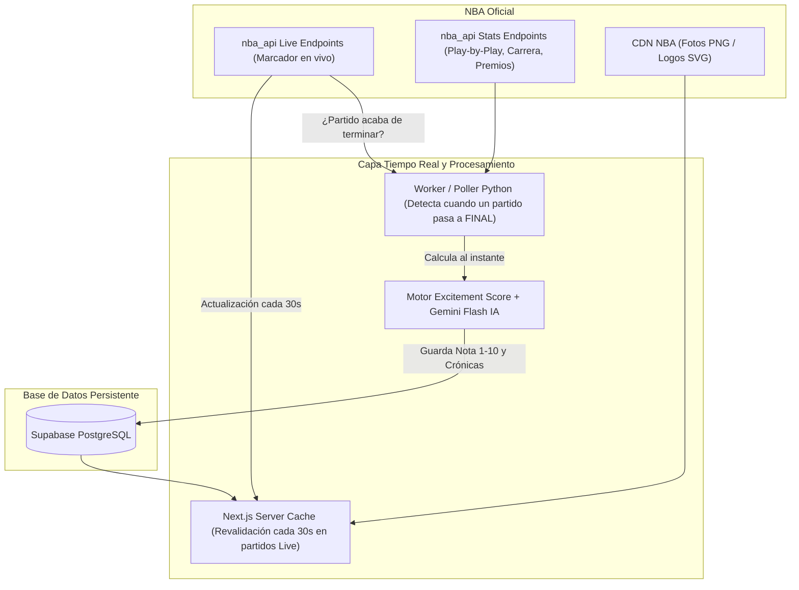
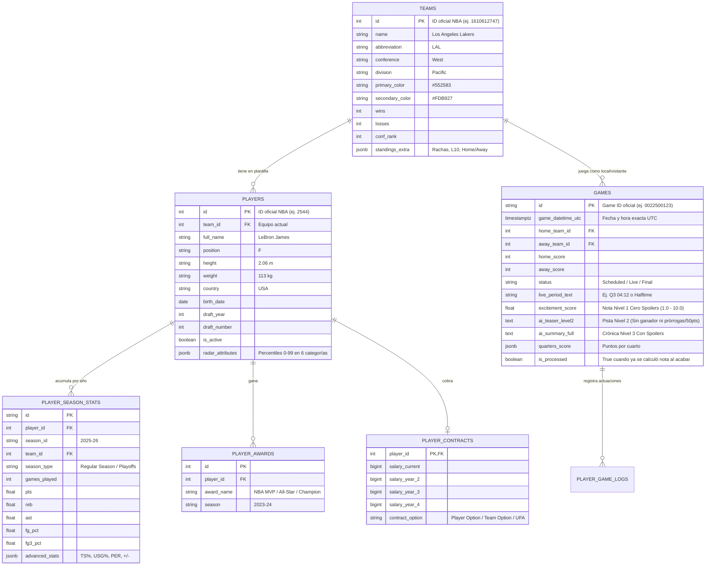

# 🏀 Proyecto NBA Full-Stack & AI Hub — Documento Maestro (`README.md`)

> **Visión del Proyecto:** La plataforma definitiva en tiempo real de seguimiento, análisis estadístico, gestión salarial e inteligencia artificial sobre la NBA en español. Diseñada con la profundidad y agilidad de **BeSoccer**, un **Modo Sin Spoilers blindado** pensado por y para verdaderos fans de la NBA, herramientas para **creadores de contenido** y un **Simulador de General Manager**.

---

## 🏷️ 1. Propuestas de Nombre (Branding)

| Nombre Propuesto | Estilo / Enfoque | Por qué funciona |
| :--- | :--- | :--- |
| **BeHoops** / **BeBasket** | Directo / Inspirado en BeSoccer | Fácil de recordar, transmite inmediatamente que es una enciclopedia viva de baloncesto. |
| **SixthMan (Sexto Hombre)** | Comunidad / Asistente IA | El "sexto hombre" que te asiste en directo y cada mañana con datos, notas y análisis. |
| **CourtVision AI** | Tecnológico / Analítico | Suena a producto SaaS moderno, ideal si quieres destacar la parte de datos e IA en LinkedIn. |
| **NoSpoiler NBA** / **WakeUp Hoops** | Nicho Europa / España | Ataca directamente el mayor dolor del fan en España: saber qué partido ver sin comerse ningún spoiler. |
| **HoopsHub** / **CanchaNBA** | Generalista / App todo-en-uno | Corto, limpio y escalable a cualquier funcionalidad futura. |

---

## 🚀 2. Funcionalidades del Producto (El Ecosistema)

El proyecto se divide en **5 pilares** que combinan tiempo real, utilidad sin spoilers, profundidad enciclopédica, viralidad en redes y retención:

### A. El Núcleo "BeSoccer" en Tiempo Real (Enciclopedia Viva y Rápida)
1. **Centro de Partidos en Vivo (Live Match Center):**
   * Calendario diario (Ayer, Hoy, Mañana) con horarios adaptados automáticamente a España (incluyendo los *NBA Sundays* por la tarde, Navidad, MLK Day y madrugadas).
   * **Marcadores en Tiempo Real (`Live`):** Actualización automática cada 30 segundos mientras se juega el partido (marcador cuarto a cuarto, tiempo restante, posesión, estadísticas en vivo de cada jugador en pista).
   * **Ficha de Partido Completo:** Comparativa de estadísticas colectivas, líderes del partido, *Boxscore* tradicional y avanzado (`TS%`, `USG%`, `PACE`, `+/-`) y **mapa de tiro interactivo**.
2. **Clasificaciones Dinámicas:**
   * Conferencia Este y Oeste actualizadas automáticamente en cuanto termina cada partido, con corte visual de **Playoffs (1-6)**, **Play-In (7-10)** y **Lotería del Draft (11-15)**.
   * Filtros por rachas, últimos 10 partidos, récord en casa/fuera y enfrentamientos directos.
3. **Perfiles de Jugadores "Estilo Videojuego":**
   * Cabecera visual con foto oficial en alta resolución, colores de su franquicia, edad, físico, posición y número.
   * **Gráfico de Radar (Araña):** Percentiles del jugador del 0 al 99 comparados con el resto de la liga en 6 categorías (Anotación, Tiro Exterior, Creación/Pase, Defensa, Rebote, Eficiencia).
   * **Trayectoria e Historial:** Estadísticas temporada a temporada en todos los equipos por los que ha pasado (Regular Season y Playoffs).
   * **Vitrina de Trofeos (Palmarés):** Iconografía visual con sus Anillos, MVPs, All-Stars, All-NBA, DPOY y récords personales (*Career Highs* de puntos, rebotes, asistencias, triples).
4. **Perfiles de Equipos (Franquicias):**
   * Plantilla actual, quinteto titular habitual, parte médico/lesionados, calendario próximo, historia de la franquicia y situación salarial.

---

### B. El Sistema "Sin Spoilers" en 3 Niveles (Pensado para Fans Reales)

> [!IMPORTANT]
> **Por qué un fan real odia los "falsos sin spoilers":** Si te dicen *"Hubo prórroga"* o *"Alguien metió 55 puntos"*, cuando estés viendo el último cuarto y un equipo gane de 3 a falta de 10 segundos, **ya sabes que van a empatar para ir a prórroga**. Eso arruina la emoción del final.

Por eso, la aplicación implementa **3 niveles de visibilidad** controlados por el usuario:

1. **🔒 Nivel 1: Modo "Cero Spoilers" (Blindado — Por defecto al activar Sin Spoilers):**
   * Oculta absolutamente todos los resultados, cuartos, rachas y estadísticas del día.
   * **SOLO muestra la Nota Numérica del Partido (`Excitement Score` del `1.0` al `10.0`)** junto con el código de color (ej. `🟢 9.3 / 10` Imprescindible, `🟡 7.1 / 10` Entretenido, `🔴 4.2 / 10` Flojo).
   * **Prohibido mostrar en este nivel:** Si hubo prórroga, si alguien hizo un récord de puntos, o cualquier pista sobre cómo termina el partido. Solo sabes la nota de espectáculo global.
2. **🕵️ Nivel 2: Modo "Pista / Teaser" (Botón opcional *"¿Por qué tiene esta nota?"* en cada partido):**
   * Solo si el usuario pulsa voluntariamente en *"Ver pista sin ganador"*, se despliega una frase generada por IA y etiquetas generales (ej. *"Ritmo ofensivo altísimo y duelo individual espectacular entre las estrellas"*) sin revelar el ganador ni el marcador final.
3. **🔓 Nivel 3: Modo "Con Spoilers" (Modo Normal / En Directo):**
   * Muestra marcadores en tiempo real o finales, cuartos, *Boxscore* completo, líderes del partido y la **Crónica Táctica IA completa** explicando por qué ganó el equipo vencedor y qué ajustes tácticos decidieron el choque.

#### ¿Cómo se calcula el `Excitement Score (1.0 - 10.0)` de forma interna al acabar cada partido?
En el instante en que un partido pasa a estado `Final`, nuestro motor en segundo plano analiza el *Play-by-Play* y calcula la nota ponderando:
* Cambios de líder (*Lead Changes*) y empates (*Times Tied*).
* Igualdad en los últimos 5 minutos (*Clutch Margin*).
* Ritmo de anotación, eficiencia de tiro y rachas espectaculares.
* Actuaciones individuales históricas (ponderadas internamente en el número, pero **nunca reveladas en texto en el Nivel 1**).

---

### C. Herramientas Interactivas y "Modo Creador de Contenido" (Viralidad en RRSS)
1. **📸 Estudio de Tarjetas para Redes Sociales (Shareable Cards 1-Click):**
   * En cualquier perfil de jugador, comparativa, clasificación, nota sin spoiler o traspaso simulado, habrá un botón **"Exportar Imagen para Redes"** (con selector de formato `16:9` para X/Twitter o `9:16` para Stories/TikTok/Instagram).
   * Genera al instante un PNG en alta definición con diseño espectacular y el sello inferior `Creado en [NombreDeTuApp]`. Ideal para que tuiteros, youtubers y aficionados compartan datos haciéndote publicidad orgánica gratis.
2. **🤖 Bot Automático de Alertas y Mañanas (X/Twitter & Telegram):**
   * Publicación automática cuando acaba un partidazo histórico (nota > 9.0) o resumen matinal con las notas limpias de la jornada para toda la comunidad española.
3. **💼 El GM Virtual (Simulador de Traspasos y Salarios):**
   * Visualizador del estado salarial de los 30 equipos (*Salary Cap*, *Luxury Tax*, *First Apron*, *Second Apron*).
   * **Trade Machine:** Intercambia jugadores y rondas del Draft entre 2 o 3 equipos validando al milímetro el convenio colectivo (CBA).
   * **Evaluador IA del Traspaso:** La IA puntúa el traspaso (`A+` a `F`) para cada franquicia explicando el encaje táctico en pista.
4. **⚔️ Comparador Cara a Cara (Head-to-Head):**
   * Enfrenta a dos jugadores actuales o históricos con gráficos de radar superpuestos y tabla comparativa lista para exportar a imagen.

### D. Gamificación y Retención Diaria (Futuras Implementaciones)
1. **La Porra Diaria (Pick'em en 15 segundos):** Elige ganadores antes de que empiecen los partidos y compite en el ranking mensual.
2. **Muro de Traspasos de la Comunidad:** Los usuarios publican sus traspasos simulados y el resto vota `🔥 Robo` o `🗑️ Desastre`.

---

## ⚡ 3. Arquitectura de Datos: Tiempo Real + Post-Partido Instantáneo

Para que los resultados se vean **en tiempo real mientras se juegan** (tardes de domingo o madrugadas) y la **nota sin spoiler + crónica IA esté lista en el minuto exacto en que suena la bocina final** (sin esperar a las 7:00 AM), usaremos una arquitectura híbrida muy inteligente y 100% gratuita:



### ¿Cómo funciona el flujo en vivo y al terminar cada partido?
1. **Mientras el partido está `En Juego (Live)`:**
   * La web/app consulta una ruta interna de nuestro servidor Next.js (`/api/live-scoreboard`) configurada con **caché compartida de 30 segundos (`revalidate: 30`)**.
   * **Por qué es brillante:** Aunque haya 2.000 personas mirando el marcador en directo en tu app, tu servidor solo hace **1 petición cada 30 segundos** al endpoint `live.nba.endpoints.scoreboard` de la NBA. Cero bloqueos de IP y marcadores en tiempo real para todos (los que tengan el *Modo Sin Spoilers* desactivado).
2. **En el instante en que un partido termina (`status == "Final"`):**
   * Nuestro proceso detector ve que el partido `ID` ha pasado a `Final` y aún no tiene calculado su `excitement_score`.
   * **Al instante (tarde o madrugada):** Descarga el *Boxscore* final y el *Play-by-Play*, calcula la nota del `1.0` al `10.0`, pide a Gemini la pista sin spoilers (Nivel 2) y la crónica completa (Nivel 3), actualiza la clasificación de las conferencias y lo guarda en Supabase.
   * Así, si un partido del domingo acaba a las 23:45 o uno entre semana acaba a las 03:30 AM, **1 minuto después ya tiene su nota lista**.
3. **Sincronización de Consolidación (Diaria / Semanal):**
   * Un job diario recalcula los percentiles globales de los radares de todos los jugadores (`0-99`) y actualiza récords personales.
   * Un job semanal (`scrape_salaries.py`) actualiza la tabla de contratos desde Basketball-Reference.

---

## 🛠️ 4. Stack Tecnológico

| Capa | Tecnología | Función en el Proyecto |
| :--- | :--- | :--- |
| **Frontend & Live Cache** | **Next.js (App Router) + React + TypeScript** | Renderizado rápido, rutas API con caché de 30s para partidos en directo y SEO. |
| **Estilos & Componentes UI** | **Tailwind CSS + shadcn/ui + Lucide Icons** | Diseño moderno en Modo Oscuro deportivo adaptable a móvil y PC. |
| **Gráficos y Tarjetas RRSS** | **Recharts + `html-to-image` / `@vercel/og`** | Gráficos de radar, mapas de tiro y generación de imágenes HD descargables para redes sociales. |
| **Empaquetado Móvil (App)** | **PWA + Capacitor.js** | Instalable desde el navegador y exportable a Google Play (Android) y App Store (iOS). |
| **Base de Datos & Realtime** | **Supabase (PostgreSQL + Realtime)** | Base de datos relacional y suscripción en tiempo real a cambios de estado de partidos. |
| **Ingesta de Datos & IA** | **Python 3.11+ (`nba_api`, `pandas`, `supabase-py`)** | Extracción en vivo/histórica, algoritmo `Excitement Score` y conexión con IA. |
| **Modelos de IA (LLMs)** | **Google Gemini API (`gemini-2.5-flash`)** | Generación instantánea de pistas Nivel 2, crónicas Nivel 3 y evaluación de traspasos. |

---

## 🗄️ 5. Esquema de Base de Datos (PostgreSQL en Supabase)



---

## 📂 6. Estructura de Carpetas del Proyecto (Monorepo)

```text
nba-app/
├── README.md                        # Este documento maestro del proyecto NBA
├── CLAUDE.md                        # Reglas operativas de bajo consumo de tokens para Claude Code
├── .gitignore
├── .github/
│   └── workflows/
│       ├── live_game_watcher.yml    # Revisa partidos terminados y dispara nota + IA al instante
│       ├── daily_stats_sync.yml     # Consolida estadísticas de temporada y radares (0-99)
│       └── weekly_salaries_sync.yml # Actualiza salarios semanalmente
│
├── backend-data/                    # 🐍 MOTOR DE DATOS, TIEMPO REAL E IA (PYTHON)
│   ├── requirements.txt
│   ├── .env.example
│   ├── config.py
│   ├── extractors/
│   │   ├── fetch_teams_players.py   # Equipos y jugadores activos/históricos
│   │   ├── fetch_live_and_final.py  # Detecta partidos en curso y recién terminados
│   │   ├── fetch_career_awards.py   # Trayectoria y palmarés de jugadores
│   │   └── scrape_salaries.py       # Salarios y contratos para el GM Virtual
│   ├── processors/
│   │   ├── excitement_calculator.py # Calcula la nota numérica pura (1.0 - 10.0) al acabar el partido
│   │   ├── player_radar_calc.py     # Calcula percentiles (0-99) de cada jugador
│   │   ├── ai_chronicler.py         # Genera Pista Nivel 2 y Crónica Nivel 3 con Gemini
│   │   └── social_bot.py            # Publica alertas en X/Twitter o Telegram (opcional)
│   └── watcher.py                   # Orquestador que procesa cada partido en cuanto pasa a 'Final'
│
└── web-app/                         # ⚛️ APLICACIÓN WEB Y MÓVIL (NEXT.JS + CAPACITOR)
    ├── package.json
    ├── next.config.ts
    ├── capacitor.config.ts
    ├── public/
    │   ├── manifest.json
    │   └── court-bg.svg
    └── src/
        ├── app/
        │   ├── layout.tsx
        │   ├── page.tsx             # HOME: Partidos en vivo/terminados + Modo Sin Spoilers (3 niveles)
        │   ├── api/
        │   │   └── live/route.ts    # Endpoint con caché de 30s para actualizar marcadores en tiempo real
        │   ├── standings/page.tsx
        │   ├── games/[id]/page.tsx
        │   ├── players/
        │   │   ├── page.tsx
        │   │   └── [id]/page.tsx
        │   ├── teams/[id]/page.tsx
        │   ├── gm-simulator/page.tsx
        │   └── compare/page.tsx
        ├── components/
        │   ├── layout/              # Sidebar, BottomNav, SpoilerModeSelector
        │   ├── games/               # LiveGameCard, PureScoreBadge (Nivel 1), TeaserDrawer (Nivel 2), BoxScore
        │   ├── players/             # PlayerRadarChart, TrophyCabinet, CareerTable
        │   ├── gm/                  # TradeMachine, SalaryCapBar, TradeEvaluationCard
        │   └── share/               # SocialCardExporter (Generador de imágenes 16:9 y 9:16 con marca de agua)
        ├── context/
        │   └── SpoilerContext.tsx   # Gestiona el modo Sin Spoilers (Nivel 1 Cero Spoilers vs Nivel 3 En Vivo)
        └── lib/
            ├── supabase.ts
            └── trade-rules.ts
```

---

## 🗺️ 7. Hoja de Ruta (Roadmap) Paso a Paso

### 🏁 Fase 0: Preparación, Entorno y Primera Prueba de Datos
* [X] **Tarea 0.1:** Crear estructura de carpetas `backend-data/`, `.gitignore` y `requirements.txt`.
* [X] **Tarea 0.2:** Crear entorno virtual Python, instalar `nba_api` y probar descarga de equipos, estadísticas de un jugador y el marcador en vivo (`live.nba.endpoints.scoreboard`).
* [X] **Tarea 0.3:** Crear proyecto en Supabase y ejecutar `schema.sql` con las tablas del punto 5.
* [X] **Tarea 0.4:** Programar `fetch_teams_players.py` para llenar `teams` y `players` en Supabase.

### 🎨 Fase 1: Esqueleto Visual Multiplataforma + Modo Sin Spoilers Blindado
* [X] **Tarea 1.1:** Inicializar **Next.js + TypeScript + Tailwind CSS + shadcn/ui** en `web-app/`.
* [X] **Tarea 1.2:** Crear layout responsive (Sidebar en PC + BottomNav en Móvil).
* [X] **Tarea 1.3:** Programar `SpoilerContext.tsx` con la regla de los **3 Niveles** (garantizando que en Nivel 1 solo se vea el número `1.0 - 10.0` sin textos ni pistas de prórroga).
* [X] **Tarea 1.4:** Construir las páginas de **Clasificaciones (`/standings`)** y **Equipos (`/teams/[id]`)**.

### 🌟 Fase 2: Fichas de Jugadores "Estilo BeSoccer" + Exportador a Redes Sociales
* [X] **Tarea 2.1:** Programar `fetch_career_awards.py` y `player_radar_calc.py` (percentiles 0-99).
* [X] **Tarea 2.2:** Diseñar `/players/[id]` con cabecera oficial, Radar de 6 atributos (`Recharts`), Vitrina de Trofeos y tabla de trayectoria histórica.
* [X] **Tarea 2.3:** Crear el componente **`SocialCardExporter`**: botón para descargar en 1 clic la ficha/radar del jugador en imagen HD (`16:9` o `9:16`) con el logo de tu app lista para subir a X/Instagram.
* [X] **Tarea 2.4:** Añadir buscador instantáneo de jugadores y equipos.

### 🔥 Fase 3: Marcadores en Tiempo Real + Nota Instantánea Post-Partido + IA
* [ ] **Tarea 3.1:** Crear la ruta `/api/live/route.ts` en Next.js con caché de 30 segundos para servir resultados y estadísticas cuarto a cuarto en directo sin saturar la API de la NBA.
* [ ] **Tarea 3.2:** Programar `excitement_calculator.py` y `ai_chronicler.py` (Gemini Flash) para que en cuanto un partido pase a `Final` calcule inmediatamente la nota `1.0 - 10.0`, la pista Nivel 2 (sin revelar prórrogas ni récords destripadores) y la crónica Nivel 3.
* [ ] **Tarea 3.3:** Construir la pantalla principal (**Home / Jornada**) con refresco en tiempo real para partidos en juego y visualización adaptada al nivel de spoiler elegido.
* [ ] **Tarea 3.4:** Construir la ficha completa del partido (`/games/[id]`) con Boxscore avanzado, cuartos, crónicas IA y botón de exportar tarjeta del partido para RRSS.

### 💼 Fase 4: El "GM Virtual" (Simulador de Traspasos) + Comparador Cara a Cara
* [ ] **Tarea 4.1:** Programar `scrape_salaries.py` para actualizar contratos de jugadores.
* [ ] **Tarea 4.2:** Programar el motor de reglas salariales CBA (`trade-rules.ts`) y la pantalla interactiva `/gm-simulator` con evaluación del traspaso por IA y exportación de imagen del traspaso para redes.
* [ ] **Tarea 4.3:** Construir el Comparador Cara a Cara (`/compare`) con radares superpuestos y tarjeta descargable.

### 📱 Fase 5: App Móvil (PWA + Capacitor), Bot de Redes y Despliegue
* [ ] **Tarea 5.1:** Configurar PWA y **Capacitor.js** para instalar la app en Android/iOS.
* [ ] **Tarea 5.2:** Desplegar la web en **Vercel** y activar los workflows automáticos en GitHub Actions.
* [ ] **Tarea 5.3:** (Opcional) Conectar `social_bot.py` a la API gratuita de X/Twitter o Telegram para publicar automáticamente las notas sin spoilers de la jornada.
