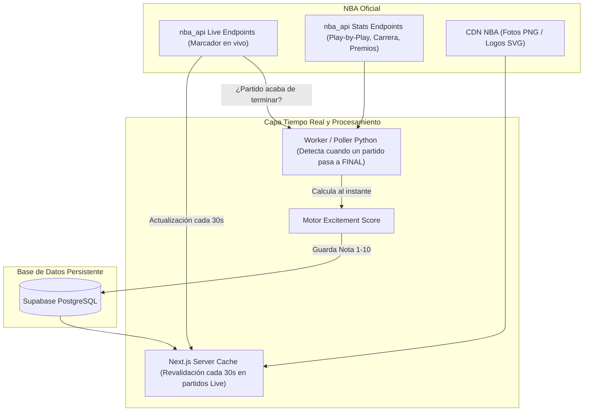
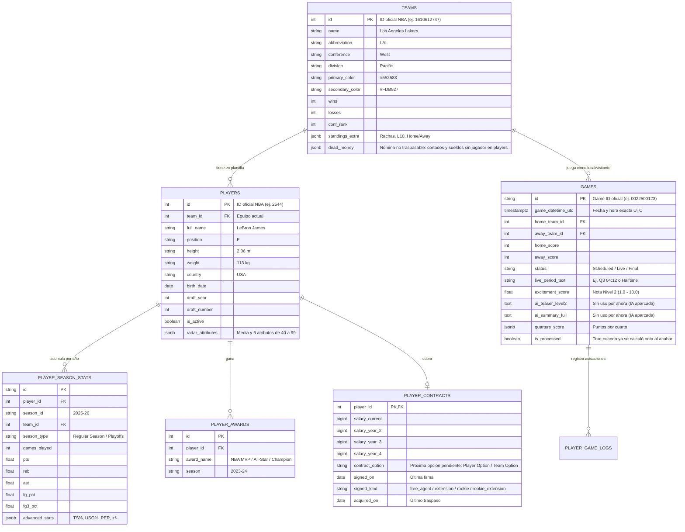

# 🏀 Proyecto NBA Full-Stack & AI Hub — Documento Maestro (`README.md`)

> **Visión del Proyecto:** La plataforma definitiva en tiempo real de seguimiento, análisis estadístico, gestión salarial e inteligencia artificial sobre la NBA en español. Diseñada con la profundidad y agilidad de **BeSoccer**, un **Modo Sin Spoilers blindado** pensado por y para verdaderos fans de la NBA, herramientas para **creadores de contenido** y un **Simulador de General Manager**.

---

## 🏷️ 1. Marca: **Hoopmeter**

* **Nombre:** *hoop* (aro, baloncesto) + *meter* (medidor). La nota de espectáculo se llama "el Hoopmeter", igual que el *Tomatometer* de Rotten Tomatoes: *"ese partido tiene un 9,3 en el Hoopmeter"*. Sin "NBA" en el nombre porque es marca registrada.
* **Eslogan:** *Qué partido ver, sin spoilers* / *Know which games are worth watching. No spoilers.*
* **Logo (E1):** un balón sobre un ojo cerrado (sin spoilers) cuyas pestañas son la escala de la nota, en los colores de la app (rojo, ámbar, esmeralda). Fuente: `web-app/assets/logo.svg` y `LogoMark.tsx`; bocetos descartados en `web-app/assets/logo-concepts/`.
* **Pendiente:** registrar `hoopmeter.com` en DonDominio (estaba libre en noviembre de 2026). TMview ya comprobado: sin registros de "Hoopmeter".

---

## 🚀 2. Funcionalidades del Producto (El Ecosistema)

El proyecto se divide en **5 pilares** que combinan tiempo real, utilidad sin spoilers, profundidad enciclopédica, viralidad en redes y retención:

### A. El Núcleo "BeSoccer" en Tiempo Real (Enciclopedia Viva y Rápida)
1. **Centro de Partidos en Vivo (Live Match Center):**
   * Calendario diario (Ayer, Hoy, Mañana) con horarios adaptados automáticamente a España (incluyendo los *NBA Sundays* por la tarde, Navidad, MLK Day y madrugadas).
   * **Marcadores en Tiempo Real (`Live`):** Actualización automática cada 30 segundos mientras se juega el partido (marcador cuarto a cuarto, tiempo restante, posesión, estadísticas en vivo de cada jugador en pista).
   * **Ficha de Partido Completo:** Comparativa de estadísticas colectivas, líderes del partido, *Boxscore* tradicional y avanzado (`TS%`, `USG%`, `PACE`, `+/-`) y **mapa de tiro interactivo**.
2. **Clasificaciones Dinámicas:**
   * Conferencia Este y Oeste actualizadas automáticamente en cuanto termina cada partido, con corte visual de **Playoffs (1-6)**, **Play-In (7-10)** y **Lotería del Draft (11-15)**.
   * Filtros por rachas, últimos 10 partidos, récord en casa/fuera y enfrentamientos directos.
3. **Perfiles de Jugadores "Estilo Videojuego":**
   * Cabecera visual con foto oficial en alta resolución, colores de su franquicia, edad, físico, posición y número.
   * **Gráfico de Radar (Araña):** 6 categorías (Anotación, Tiro Exterior, Creación/Pase, Defensa, Rebote, Eficiencia) de 40 a 99 frente a los jugadores de rotación de la temporada, y una Media de 40 a 99 para todo el que ha jugado.
   * **Trayectoria e Historial:** Estadísticas temporada a temporada en todos los equipos por los que ha pasado (Regular Season y Playoffs).
   * **Vitrina de Trofeos (Palmarés):** Iconografía visual con sus Anillos, MVPs, All-Stars, All-NBA, DPOY y récords personales (*Career Highs* de puntos, rebotes, asistencias, triples).
4. **Perfiles de Equipos (Franquicias):**
   * Plantilla actual, quinteto titular habitual, parte médico/lesionados, calendario próximo, historia de la franquicia y situación salarial.

---

### B. El Sistema "Sin Spoilers" en 3 Niveles (Pensado para Fans Reales)

> [!IMPORTANT]
> **Por qué un fan real odia los "falsos sin spoilers":** Si te dicen *"Hubo prórroga"* o *"Alguien metió 55 puntos"*, cuando estés viendo el último cuarto y un equipo gane de 3 a falta de 10 segundos, **ya sabes que van a empatar para ir a prórroga**. Eso arruina la emoción del final.

Por eso, la aplicación implementa **3 niveles de visibilidad** controlados por el usuario:

1. **🔒 Nivel 1: "Todo oculto" (por defecto, SIEMPRE al abrir la app):**
   * Solo los partidos de la jornada (emparejamientos y hora). Ni nota, ni resultados, ni estado del partido.
2. **⭐ Nivel 2: "Solo nota" (un toque):**
   * Añade la **Nota Numérica del Partido (`Excitement Score` del `1.0` al `10.0`)** con su código de color para elegir qué partidos ver. Se lee como una nota del colegio: `🟢 8+` partidazo (~1 de cada 5), `🟡 5-7.9` se deja ver (el partido normal ronda el 6) y `🔴 <5` flojo (se decidió antes del último cuarto).
   * **Prohibido:** si hubo prórroga, si alguien hizo un récord de puntos o cualquier pista sobre cómo termina el partido. Solo la nota de espectáculo global.
3. **🔓 Nivel 3: "Resultados" (manteniendo pulsado 1 segundo):**
   * Marcadores en tiempo real o finales (junto a la nota), cuartos, *Boxscore* completo y líderes del partido.

> **La garantía:** con otras apps (incluida la oficial de la NBA) siempre se te olvida cambiar de modo y acabas comiéndote un spoiler. Aquí la app **vuelve sola al Nivel 1** cada vez que se abre (o tras 15 min en segundo plano), y llegar a los resultados exige mantener pulsado: un toque accidental nunca destripa nada.

#### ¿Cómo se calcula el `Excitement Score (1.0 - 10.0)` de forma interna al acabar cada partido?
En el instante en que un partido pasa a estado `Final`, nuestro motor en segundo plano analiza el *Play-by-Play* y reconstruye la **probabilidad de victoria segundo a segundo** (marcador, tiempo por jugar y ventaja de campo; ajustada con 1.527 partidos de 2025-26 y 2026-27). Con ella pondera:
* Hasta cuándo tuvo opciones el perdedor: vivo al llegar al último cuarto y en los últimos minutos.
* Vuelcos al final del tiempo reglamentario, igualdad durante el partido y remontadas (de cualquiera de los dos equipos).
* Ritmo de anotación y acierto.
* Actuaciones individuales históricas (ponderadas internamente en el número, pero **nunca reveladas en texto junto a la nota**).
* La prórroga **no tiene plus propio**: con él, 9 de cada 10 notas de 9+ eran prórrogas y la nota la delataba. Ya puntúa por cómo se llega a ella.

---

### C. Herramientas Interactivas y "Modo Creador de Contenido" (Viralidad en RRSS)
1. **📸 Estudio de Tarjetas para Redes Sociales (Shareable Cards 1-Click):**
   * En cualquier perfil de jugador, comparativa, clasificación, nota sin spoiler o traspaso simulado, habrá un botón **"Exportar Imagen para Redes"** (con selector de formato `16:9` para X/Twitter o `9:16` para Stories/TikTok/Instagram).
   * Genera al instante un PNG en alta definición con diseño espectacular y el sello inferior `Creado en [NombreDeTuApp]`. Ideal para que tuiteros, youtubers y aficionados compartan datos haciéndote publicidad orgánica gratis.
2. **🤖 Bot Automático de Alertas y Mañanas (X/Twitter & Telegram):**
   * Publicación automática cuando acaba un partidazo histórico (nota > 9.0) o resumen matinal con las notas limpias de la jornada para toda la comunidad española.
3. **💼 El GM Virtual (Simulador de Traspasos y Salarios):**
   * Visualizador del estado salarial de los 30 equipos (*Salary Cap*, *Luxury Tax*, *First Apron*, *Second Apron*).
   * **Trade Machine:** Intercambia jugadores y rondas del Draft entre 2 o 3 equipos validando al milímetro el convenio colectivo (CBA).
   * **Evaluador IA del Traspaso:** La IA puntúa el traspaso (`A+` a `F`) para cada franquicia explicando el encaje táctico en pista.
4. **⚔️ Comparador Cara a Cara (Head-to-Head):**
   * Enfrenta a dos jugadores actuales o históricos con gráficos de radar superpuestos y tabla comparativa lista para exportar a imagen.

### D. Juegos, Premios y Retención Diaria (Fase 8)
1. **Retos diarios en `/juegos`:** 2-3 minutos al día, sin cuenta para jugar. Los puntos solo suman (nunca se pierden por fallar) y la racha tiene escudo.
2. **Premios únicos para presumir:** piezas 3D propias de Hoopmeter para los campeones del día, la semana, el mes y la temporada, cada una distinta de todas las demás y con el alias grabado. Sin sobres, sin azar, sin dinero y sin jugadores reales.
3. **Ligas privadas con amigos** por enlace de WhatsApp y **La Porra** y **El Quinteto** de cada noche, siempre con la regla de los niveles de spoilers.

---

## ⚡ 3. Arquitectura de Datos: Tiempo Real + Post-Partido Instantáneo

Para que los resultados se vean **en tiempo real mientras se juegan** (tardes de domingo o madrugadas) y la **nota sin spoiler esté lista en el minuto exacto en que suena la bocina final** (sin esperar a las 7:00 AM), usaremos una arquitectura híbrida muy inteligente y 100% gratuita:



### ¿Cómo funciona el flujo en vivo y al terminar cada partido?
1. **Mientras el partido está `En Juego (Live)`:**
   * La web/app consulta una ruta interna de nuestro servidor Next.js (`/api/live-scoreboard`) configurada con **caché compartida de 30 segundos (`revalidate: 30`)**.
   * **Por qué es brillante:** Aunque haya 2.000 personas mirando el marcador en directo en tu app, tu servidor solo hace **1 petición cada 30 segundos** al endpoint `live.nba.endpoints.scoreboard` de la NBA. Cero bloqueos de IP y marcadores en tiempo real para todos (los que tengan el *Modo Sin Spoilers* desactivado).
2. **En el instante en que un partido termina (`status == "Final"`):**
   * Nuestro proceso detector ve que el partido `ID` ha pasado a `Final` y aún no tiene calculado su `excitement_score`.
   * **Al instante (tarde o madrugada):** Descarga el *Boxscore* final y el *Play-by-Play*, calcula la nota del `1.0` al `10.0` y la guarda en Supabase.
   * Así, si un partido del domingo acaba a las 23:45 o uno entre semana acaba a las 03:30 AM, **minutos después ya tiene su nota lista** (GitHub Actions lanza el watcher cada 5 minutos).
   * Quien lanza el watcher a la hora exacta es Supabase (`pg_cron`, `backend-data/cron.sql`): el programador de GitHub se retrasa horas en repos gratuitos y queda solo como respaldo.
   * En la misma pasada guarda el boxscore del partido y recalcula la clasificación (victorias, casa/fuera, rachas y puesto con los desempates oficiales de la NBA).
3. **Sincronización de Consolidación (Diaria / Semanal):**
   * **Sin `stats.nba.com` (Tarea 5.2b):** la NBA bloquea las IPs de la nube, así que todo lo automático sale de la CDN y de las páginas públicas de nba.com. Las estadísticas de temporada, la carrera, los récords y el radar se calculan con los boxscores guardados; las cifras se comparan con las correcciones oficiales de nba.com (la CDN no las recoge) y cada partido se vuelve a comprobar una vez por semana. Validado con la temporada 2025-26 completa frente a las cifras oficiales.
   * Un job diario (10:30 UTC) sincroniza el calendario, pone las notas pendientes, refresca boxscores, clasificación, estadísticas, carrera, récords y radares (`40-99`), y completa la ficha de los jugadores nuevos. Los promedios cambian solo aquí: la ficha de un partido los enseña en el Nivel 1.
   * Desde un PC, solo de vez en cuando: `fetch_career_awards.py` para los premios (All-Star, premios de final de temporada, campeón) y para el historial de veteranos que lleguen nuevos a la base de datos.
   * Varias veces al día (cada pocos minutos en julio y en la fecha límite), `fetch_transactions.py` aplica a los contratos el registro oficial de movimientos de la NBA y, justo después, `fetch_contract_news.py` pone las cifras que publican los medios fiables. `scrape_salaries.py` (Basketball-Reference) solo se usó para la carga inicial.

---

## 🛠️ 4. Stack Tecnológico

| Capa | Tecnología | Función en el Proyecto |
| :--- | :--- | :--- |
| **Frontend & Live Cache** | **Next.js (App Router) + React + TypeScript** | Renderizado rápido, rutas API con caché de 30s para partidos en directo y SEO. |
| **Estilos & Componentes UI** | **Tailwind CSS + shadcn/ui + Lucide Icons** | Diseño moderno en Modo Oscuro deportivo adaptable a móvil y PC. |
| **Gráficos y Tarjetas RRSS** | **Recharts + `html-to-image` / `@vercel/og`** | Gráficos de radar, mapas de tiro y generación de imágenes HD descargables para redes sociales. |
| **Empaquetado Móvil (App)** | **PWA + Capacitor.js** | Instalable desde el navegador y exportable a Google Play (Android) y App Store (iOS). |
| **Base de Datos & Realtime** | **Supabase (PostgreSQL + Realtime)** | Base de datos relacional y suscripción en tiempo real a cambios de estado de partidos. |
| **Ingesta de Datos & IA** | **Python 3.11+ (`nba_api`, `pandas`, `supabase-py`)** | Extracción en vivo/histórica, algoritmo `Excitement Score` y conexión con IA. |
| **Modelos de IA (LLMs)** | **Google Gemini API (Flash)** | Evaluación de traspasos (Fase 4). Las crónicas de partidos están aparcadas por ahora. |

---

## 🗄️ 5. Esquema de Base de Datos (PostgreSQL en Supabase)



---

## 📂 6. Estructura de Carpetas del Proyecto (Monorepo)

```text
hoopmeter/
├── README.md                        # Este documento maestro del proyecto NBA
├── CLAUDE.md                        # Reglas operativas de bajo consumo de tokens para Claude Code
├── .gitignore
├── .github/
│   └── workflows/
│       ├── live_game_watcher.yml    # Cada 5 min: nota, boxscore y clasificación de cada partido que termina
│       ├── daily_stats_sync.yml     # Diario: calendario, boxscores corregidos, estadísticas, carrera, radares, fichas y aviso de errores
│       ├── contracts_sync.yml       # Aplica el registro oficial de movimientos (varias veces al día)
│       └── morning_push.yml         # Aviso matinal sin spoilers (8, 9 o 10 de España)
│
├── backend-data/                    # 🐍 MOTOR DE DATOS, TIEMPO REAL E IA (PYTHON)
│   ├── requirements.txt
│   ├── .env.example
│   ├── config.py
│   ├── db.py                        # Utilidades de Supabase (paginación, upsert, sync_status)
│   ├── extractors/
│   │   ├── nba_cdn.py               # CDN de la NBA (calendario, boxscores, índice de jugadores), con reintentos
│   │   ├── nba_web.py               # Páginas de nba.com: boxscore oficial corregido y ficha del jugador
│   │   ├── fetch_teams_players.py   # Equipos y jugadores activos (stats.nba.com: solo desde un PC)
│   │   ├── fetch_live_and_final.py  # Calendario (CDN) y partidos de hoy en directo
│   │   ├── fetch_boxscores.py       # Boxscores CDN + correcciones oficiales -> player/team_game_stats
│   │   ├── fetch_player_bios.py     # Ficha de los jugadores nuevos (altura, peso, draft...)
│   │   ├── fetch_career_awards.py   # Trayectoria, totales exactos y palmarés (stats.nba.com: solo desde un PC)
│   │   ├── fetch_league_averages.py # Ritmo y medias de la liga por temporada (tabla de la web)
│   │   ├── fetch_legends.py         # Leyendas retiradas para el comparador y sus fichas
│   │   ├── fetch_transactions.py    # Registro oficial de movimientos de la NBA -> contratos del GM
│   │   ├── fetch_contract_news.py   # Cifras de los contratos desde los RSS de Hoops Rumors y RealGM
│   │   └── scrape_salaries.py       # Carga inicial de contratos (Basketball-Reference, no se programa)
│   ├── processors/
│   │   ├── cba.py                   # Cifras del convenio de la temporada (revisar cada verano)
│   │   ├── contract_engine.py       # Reglas puras: qué hace cada fichaje, corte o traspaso a los contratos
│   │   ├── contract_news.py         # Lee en una noticia las condiciones del contrato de un jugador
│   │   ├── contract_resolver.py     # Decide las cifras (exactas, ≈ o sin cifra) a partir de las noticias
│   │   ├── excitement_calculator.py # Calcula la nota numérica pura (1.0 - 10.0) al acabar el partido
│   │   ├── morning_digest.py        # Texto del aviso matinal (puro, nunca resultados)
│   │   ├── box_stats.py             # Boxscore -> filas por jugador y equipo, con comprobaciones (puro)
│   │   ├── standings.py             # Clasificación y desempates oficiales de la NBA (puro)
│   │   ├── standings_calc.py        # Calcula y guarda la clasificación (una sola transacción)
│   │   ├── season_stats.py          # Temporada, carrera, récords y métricas del radar (puro)
│   │   ├── season_stats_calc.py     # Calcula y guarda temporada, carrera y récords
│   │   ├── player_radar_calc.py     # Radar y media (40-99) de cada jugador
│   │   ├── ai_chronicler.py         # APARCADO: textos IA con Gemini (fuera del pipeline)
│   │   └── social_bot.py            # Publica alertas en X/Twitter o Telegram (opcional)
│   ├── tests/                       # Tests sin red ni base de datos (python -m unittest discover -s tests -t .)
│   ├── push.sql                     # Suscripciones del aviso matinal (tabla privada + alta/baja)
│   ├── errors.sql                   # Errores en producción (tabla privada app_errors + report_app_error)
│   ├── gm.sql                       # Evaluaciones del GM guardadas y tope diario (tablas privadas + clave en el Vault)
│   ├── check_errors.py              # Aviso diario de errores nuevos (job diario: falla → email de GitHub)
│   ├── notify_morning.py            # Envía el aviso matinal (web push y FCM)
│   └── watcher.py                   # Orquestador que procesa cada partido en cuanto pasa a 'Final'
│
└── web-app/                         # ⚛️ APLICACIÓN WEB Y MÓVIL (NEXT.JS + CAPACITOR)
    ├── package.json
    ├── next.config.ts
    ├── vercel.json                  # Región de las funciones: fra1 (Fráncfort, junto a la base de datos)
    ├── capacitor.config.ts          # La app nativa carga la web desplegada (CAPACITOR_SERVER_URL)
    ├── android/ · ios/              # Proyectos nativos de Capacitor
    ├── assets/logo.svg              # Logo provisional: fuente de todos los iconos (`npm run icons`)
    ├── scripts/                     # generate-icons.mjs, prepare-native-shell.mjs
    ├── public/
    │   ├── sw.js                    # Service worker: solo navegaciones y página sin conexión
    │   ├── offline.html
    │   ├── icons/
    │   └── logos/                   # Escudos de los 30 equipos (`npm run logos`)
    └── src/
        ├── proxy.ts                 # Direcciones antiguas de las fichas -> con nombre (308)
        ├── app/
        │   ├── layout.tsx
        │   ├── manifest.ts          # Manifiesto de la PWA
        │   ├── opengraph-image.tsx  # Imagen de la marca al compartir un enlace (también en games/players/teams [id])
        │   ├── sitemap.ts · robots.ts
        │   ├── og/compare/route.tsx # Imagen del duelo del comparador
        │   ├── page.tsx             # HOME: Partidos en vivo/terminados + Modo Sin Spoilers (3 niveles)
        │   ├── api/
        │   │   ├── live/route.ts    # Endpoint con caché de 30s para actualizar marcadores en tiempo real
        │   │   └── errors/route.ts  # Errores del navegador -> app_errors (Tarea 6.27)
        │   ├── error.tsx · global-error.tsx  # Pantalla de error en español + aviso
        │   ├── standings/page.tsx
        │   ├── games/[id]/page.tsx
        │   ├── players/
        │   │   ├── page.tsx             # Buscador + explorador de estadísticas (filtros en la URL)
        │   │   └── [id]/page.tsx
        │   ├── teams/
        │   │   ├── page.tsx             # Los 30 equipos por conferencia y división
        │   │   └── [id]/page.tsx        # Ficha: plantilla ordenable, últimos y próximos partidos
        │   ├── que-ver/page.tsx         # Mejores partidos por nota (semana, mes, temporada), sin resultados
        │   ├── avisos/page.tsx          # Aviso de la mañana: activar, hora y sin/con notas
        │   ├── acerca/ · privacidad/ · aviso-legal/  # Páginas legales (pie de todas las páginas)
        │   ├── gm-simulator/page.tsx
        │   └── compare/page.tsx
        ├── components/
        │   ├── layout/              # Sidebar, BottomNav, SpoilerModeSelector
        │   ├── games/               # LiveGameCard, PureScoreBadge (Nivel 2), BoxScore
        │   ├── players/             # PlayerRadarChart, TrophyCabinet, CareerTable, PlayerExplorer + ExplorerTable
        │   ├── teams/               # RosterTable, TeamRecentGames (según el nivel), TeamGameRow
        │   ├── gm/                  # TradeMachine, SalaryCapBar, TradeEvaluationCard
        │   ├── compare/             # CompareView, DuelRadar, DuelRows, EraAdjust, PlayerPicker
        │   ├── favorites/           # FavoriteButton (★ de las fichas), franja y bloque de favoritos
        │   └── share/               # SocialCardExporter (imágenes 16:9 y 9:16 y vídeo MP4 9:16 con marca de agua), GameVideo
        ├── context/
        │   └── SpoilerContext.tsx   # Nivel de spoilers 1-2-3 (siempre arranca en 1)
        └── lib/
            ├── supabase.ts
            ├── routes.ts            # Direcciones con nombre de jugadores y equipos
            ├── structured-data.ts   # Datos de schema.org para buscadores (solo Nivel 1); arenas.ts es generado
            ├── cache-window.ts      # Hasta cuándo vale cada cosa en la CDN y en las cachés compartidas
            └── trade-rules.ts
```

---

## 🗺️ 7. Hoja de Ruta (Roadmap) Paso a Paso

### 🏁 Fase 0: Preparación, Entorno y Primera Prueba de Datos
* [X] **Tarea 0.1:** Crear estructura de carpetas `backend-data/`, `.gitignore` y `requirements.txt`.
* [X] **Tarea 0.2:** Crear entorno virtual Python, instalar `nba_api` y probar descarga de equipos, estadísticas de un jugador y el marcador en vivo (`live.nba.endpoints.scoreboard`).
* [X] **Tarea 0.3:** Crear proyecto en Supabase y ejecutar `schema.sql` con las tablas del punto 5.
* [X] **Tarea 0.4:** Programar `fetch_teams_players.py` para llenar `teams` y `players` en Supabase.

### 🎨 Fase 1: Esqueleto Visual Multiplataforma + Modo Sin Spoilers Blindado
* [X] **Tarea 1.1:** Inicializar **Next.js + TypeScript + Tailwind CSS + shadcn/ui** en `web-app/`.
* [X] **Tarea 1.2:** Crear layout responsive (Sidebar en PC + BottomNav en Móvil).
* [X] **Tarea 1.3:** Programar `SpoilerContext.tsx` con la regla de los **3 Niveles** (redefinidos en la 3.2: 1 Todo oculto · 2 Solo nota · 3 Resultados).
* [X] **Tarea 1.4:** Construir las páginas de **Clasificaciones (`/standings`)** y **Equipos (`/teams/[id]`)**.

### 🌟 Fase 2: Fichas de Jugadores "Estilo BeSoccer" + Exportador a Redes Sociales
* [X] **Tarea 2.1:** Programar `fetch_career_awards.py` y `player_radar_calc.py` (percentiles 0-99).
* [X] **Tarea 2.2:** Diseñar `/players/[id]` con cabecera oficial, Radar de 6 atributos (`Recharts`), Vitrina de Trofeos y tabla de trayectoria histórica.
* [X] **Tarea 2.3:** Crear el componente **`SocialCardExporter`**: botón para descargar en 1 clic la ficha/radar del jugador en imagen HD (`16:9` o `9:16`) con el logo de tu app lista para subir a X/Instagram.
* [X] **Tarea 2.4:** Añadir buscador instantáneo de jugadores y equipos.

### 🔥 Fase 3: Marcadores en Tiempo Real + Nota Instantánea Post-Partido + IA
* [X] **Tarea 3.1:** Crear la ruta `/api/live/route.ts` en Next.js con caché de 30 segundos para servir resultados y estadísticas cuarto a cuarto en directo sin saturar la API de la NBA.
* [X] **Tarea 3.2:** Programar el calendario completo (`fetch_live_and_final.py`), `excitement_calculator.py` y `watcher.py` para que en cuanto un partido pase a `Final` calcule inmediatamente la nota `1.0 - 10.0`. Niveles de spoiler redefinidos (1 Todo oculto · 2 Solo nota · 3 Resultados) con arranque siempre en Nivel 1. *(Textos IA aparcados.)*
* [X] **Tarea 3.3:** Construir la pantalla principal (**Home / Jornada**) con refresco en tiempo real para partidos en juego y visualización adaptada al nivel de spoiler elegido.
* [X] **Tarea 3.4:** Construir la ficha completa del partido (`/games/[id]`) con Boxscore avanzado, cuartos, gráficos y mapa de tiro, y botón de exportar tarjeta del partido para RRSS.

### 💼 Fase 4: El "GM Virtual" (Simulador de Traspasos) + Comparador Cara a Cara
* [X] **Tarea 4.1:** Programar `scrape_salaries.py` para actualizar contratos de jugadores.
* [X] **Tarea 4.2:** Programar el motor de reglas salariales CBA (`trade-rules.ts`) y la pantalla interactiva `/gm-simulator` con evaluación del traspaso por IA y exportación de imagen del traspaso para redes.
* [X] **Tarea 4.3:** Construir el Comparador Cara a Cara (`/compare`) con radares superpuestos y tarjeta descargable.
* [X] **Tarea 4.4:** Contratos automáticos y fiables sin raspar Basketball-Reference:
  * [X] **Fase 1 — Movimientos oficiales:** `fetch_transactions.py` aplica el registro oficial de la NBA (fichajes, cortes, traspasos, reclamados y conversiones) con las reglas de `contract_engine.py` (tests incluidos). Un contrato firmado sin cifra pública queda "pendiente": el GM lo marca, pide la estimación del usuario y la señala como tal en el veredicto, en la IA y en la imagen. El dinero muerto dudoso (garantías, *stretch*) queda "por confirmar".
  * [X] **Fase 2 — Cifras desde noticias:** `fetch_contract_news.py` lee los RSS de Hoops Rumors y RealGM (respetando su *crawl-delay*). `contract_news.py` extrae solo lo que la noticia afirma de ese jugador y ese equipo. `contract_resolver.py` decide: mínimos y excepciones completas exactos con las tablas del convenio (`cba.py`), cifras redondeadas de la prensa como aproximadas (≈), y ante cualquier contradicción, sin cifra. Prueba con los fichajes de julio de 2026: 12 de 12 cifras exactas correctas.
  * La fase 3 (cambio de temporada) pasa a la **Tarea M.1**.
  * Descartado: Gemini con búsqueda de Google. Sus condiciones prohíben guardar sus resultados o crear una base de datos con ellos.

### 📱 Fase 5: App Móvil (PWA + Capacitor), Despliegue y Automatización
* [X] **Tarea 5.1:** PWA (manifiesto, service worker, página sin conexión) y **Capacitor.js** para Android con la web desplegada (`server.url`). *La prueba del APK en un móvil real es la Tarea 6.2.*
* [X] **Tarea 5.2:** Web en **Vercel** con el dominio **hoopmeter.com** y workflows de GitHub Actions (watcher cada 5 min, contratos cada hora, estadísticas a diario).
  * [X] **Tarea 5.2b:** Datos sin `stats.nba.com` (bloquea la nube): calendario desde la CDN, boxscores con las correcciones oficiales de nba.com, clasificación con desempates oficiales, estadísticas, carrera, récords, radar y fichas calculados desde GitHub Actions. Validado con la temporada 2025-26 completa y con la actual frente a las cifras oficiales.
  * [X] Supabase (`pg_cron`, `backend-data/cron.sql`) lanza los workflows a la hora exacta: el programador de GitHub se retrasaba horas.
  * [X] La web lee los datos en directo del origen S3 de la NBA: `cdn.nba.com` bloquea los servidores de Vercel.
* [ ] **Tarea 5.3:** (Al lanzar) Canal de Telegram con la jornada de anoche: texto de `morning_digest.py` "con notas" (nota del mejor y cuántos 8+), nunca marcadores, ganador, prórroga ni frases como "final de infarto". Lo envía el mismo job del aviso matinal y se enlaza desde `/avisos`. X y WhatsApp, a mano.

### 🚀 Fase 6: Lanzamiento (antes de publicitar la app)
* [X] **Tarea 6.1:** Pulido para móvil y Modo Creador para todo: letra base más compacta en móvil, cabecera de la jornada en una franja, filas de partidos y clasificación más bajas, logos para fondo oscuro. Botón "Compartir imagen" en todas las pantallas con **vista previa exacta**, qué incluye la imagen y aviso de spoilers; tarjetas nuevas de **jornada** (según el nivel), **clasificación** y **equipo**. Recorrido de la web publicada: GM con IA, comparador, buscador y auditoría de spoilers correctos.
* [X] **Tarea 6.2:** Probar la app nativa (APK) en el dispositivo móvil contra la web publicada (`CAPACITOR_SERVER_URL=https://hoopmeter.com`): arranque siempre en Nivel 1 (también al volver de segundo plano), exportar y compartir imágenes desde Android, botón atrás, modo sin conexión y aspecto en pantalla completa. Todo correcto en un Galaxy S24; el botón atrás en la portada no hacía nada y ahora cierra el diálogo abierto, vuelve atrás o pasa la app a segundo plano.
* **Mejoras de la auditoría del 17-nov-2026** (`info_17nov/`, contrastada con el código; la jornada por defecto se queda como está: "Hoy" = la fecha de la NBA):
* [X] **Tarea 6.3:** Retoques rápidos de interfaz: en la lista de partidos, marcar quién es visitante y quién local (`LiveGameCard.tsx`, hoy el visitante va arriba sin indicarlo); botón "← Volver" visible en la ficha del partido (iPhone con la web instalada y escritorio no tienen otro); texto corto junto a los iconos del selector de spoilers en móvil (Ocultar · Nota · Resultados, sin salirse a 360 px); el subtítulo de la portada en móvil se corta ("HORA DE E…"); el botón "Compartir imagen" pasa a ser solo el icono (con `aria-label` y *tooltip*) en todas las pantallas, actualizando CLAUDE.md §4.C.
* [X] **Tarea 6.4:** Comparador: la barra de "Pérdidas" ya es más larga para quien pierde menos, y "Defensa" suma desviaciones típicas de robos y tapones en vez de percentiles, que topaban en 99 (2026-27: Wembanyama 99 y Jokić 93, antes 94 y 97; Mutombo pasa de 49 a 96 en su carrera). "Tiro exterior" sigue con percentiles: con desviaciones el volumen de triples se comía el porcentaje.
* [X] **Tarea 6.5:** Nota justa: `excitement_score` rehecho sobre la probabilidad de victoria segundo a segundo (ajustada con 1.527 partidos de 2025-26 y 2026-27) con el desglose vivo al último cuarto · final en el aire · final de infarto · igualdad · remontada · ataque · individual, calibrado con notas puestas a mano a 112 partidos. 2025-26: mediana 3,6 → 6,0, suspensos 66 % → 35 %, 8+ 4 % → 21 %; ORL-BOS `0022600245` 4,6 → 6,7. Sin plus por prórroga para que el 9+ no la delate. Colores 🟢 8+ · 🟡 5-7,9 · 🔴 <5 y leyenda en el Nivel 2; tests en `tests/test_excitement.py` y `spoilers.test.ts`; notas guardadas recalculadas con `python -m processors.excitement_calculator --rescore`.
* [X] **Tarea 6.6:** Clasificación y equipos según el nivel de spoilers, sin botones ni confirmaciones nuevas: en Niveles 1 y 2, clasificación y cabecera de equipo (balance, posición, racha, últimos 10, casa/fuera, diferencia) **antes de la última jornada empezada**, con la línea "Antes de la jornada del lun 16 · mantén pulsado Resultados para verla al día"; en Nivel 3, al día. Los datos al día solo se piden en Nivel 3 (como `/api/live`) y las tarjetas de compartir siguen el nivel. Actualizar el alcance de CLAUDE.md §4.A.
* [X] **Tarea 6.7:** Ficha de equipo estilo BeSoccer y página de los 30 equipos: plantilla ordenada por minutos con PJ, MIN, PTS, REB, AST, %T3 y salario 2026-27 (≈ aproximado, "Sin cifra" si está pendiente) y columnas ordenables (`lib/team-roster.ts`, con tests); últimos partidos encima de los próximos (Nivel 1: rival y fecha en el HTML; Nivel 2: + nota; Nivel 3: + resultado, desde `/api/teams/[id]/games` filtrado con `redactGame`); página `/teams` con los 30 equipos por conferencia y división, enlazada desde la clasificación.
* [X] **Tarea 6.8:** Ficha de jugador: contrato año a año (`lib/player-contract.ts`, con tests: "≈" en las aproximadas, "Sin cifra" en las `pending` con lo que publicó la prensa, renovación sin cifra y la opción pendiente sin colocarla en un año que la tabla no dice) con botón "Simular traspaso" (`/gm-simulator?jugador=ID`: su equipo ya elegido y él entra al elegir el otro); últimos partidos de su equipo según el nivel (como en 6.7) y, solo en Nivel 3, su línea de cada partido desde `/api/players/[id]/games` (boxscore de la CDN ya cacheado); máximos de la temporada (`advanced_stats.season_highs`, solo en el job diario como los promedios). Los récords de carrera siguen saliendo solo si hay historial oficial completo.
* [X] **Tarea 6.9:** GM: el traspaso en la URL (solo ids: `?equipos=…&jugadores=id-destino&rondas=…&estimaciones=…`, `lib/gm-link.ts` con tests), siempre al día en la barra de direcciones y con botón "Compartir enlace" junto al de la imagen (menú de compartir en móvil y en la app nativa, copiar en escritorio). Al abrirlo se reconstruye con los contratos de hoy (`restoreTrade` + `buildTrade`) y el veredicto se recalcula con `trade-rules.ts`; lo que ya no se puede montar (jugador traspasado o cortado, ronda caducada, estimación de un contrato que ya tiene cifra) sale del traspaso con un aviso.
* [X] **Tarea 6.10:** Equipos y jugadores favoritos, sin cuenta (guardados en el dispositivo, `lib/favorites.ts` con tests + `lib/favorites-store.ts`): ★ en la cabecera de su ficha (un toque); en la portada, los partidos de tus equipos y de los equipos de tus jugadores primero, con franja naranja y ★ en el equipo (mismo orden y mismo destacado en los 3 niveles: nunca enseñan más que el nivel); acceso rápido en una franja de la portada (móvil) y en la Sidebar (escritorio). Una cookie con solo los ids (`hm_fav`) deja que el servidor pinte la portada ya ordenada, sin saltos; el equipo de cada jugador se pone al día con el buscador (traspasos). Los favoritos nunca cambian el nivel de spoilers.
* **Funciones propias para dar el salto (propuestas el 17-nov-2026):**
* [X] **Tarea 6.11:** "Qué ver" (`/que-ver`, en la Sidebar y la BottomNav): los mejores partidos de los últimos 7 días, 30 días o la temporada ordenados por nota (a igual nota, el más reciente), filtrables por equipo o por tus favoritos, con "El partidazo de la semana" arriba y el filtro en la URL (`?periodo=mes&equipo=ID|favoritos`). En Nivel 1 no sale ningún partido (el orden ya delataría la nota), solo un botón de un toque a "Solo nota"; en Niveles 2 y 3, emparejamiento y nota, **nunca resultados**. Las notas salen de `/api/what-to-watch?level=2` (solo id, fecha, equipos y nota; los marcadores ni se leen) y la lógica es pura en `lib/what-to-watch.ts`, con tests.
* [X] **Tarea 6.12:** "Los nuestros": franja en la portada (bajo el aviso del nivel, solo si hay alguno) con los españoles que juegan esa jornada (`players.country = 'Spain'`, activos y con equipo), con acceso a su ficha. En Niveles 1 y 2, equipo, rival y hora (salen del calendario: ni siquiera si llegó a jugar); en Nivel 3, su línea ("10 PTS · 6 REB · 8 AST" o "No jugó · Lesión") desde `/api/los-nuestros?level=3` (boxscore de la CDN ya cacheado), refrescada con la jornada. Lógica pura en `lib/spanish-players.ts`, con tests. Se usa el equipo actual: en jornadas pasadas, un traspasado sale con su equipo nuevo y sin línea.
* [X] **Tarea 6.13:** Modo diferido (segunda pantalla): en la ficha del partido, en Niveles 1 y 2 y si ya es la hora, "Lo veo en diferido"; el usuario indica por dónde va (botones de cuarto, prórroga siempre visible, −1/+1 min) y ve marcador, cuartos, boxscore, tiros y jugada a jugada **solo hasta ese instante**, sin nota (tampoco en Nivel 2) ni tarjeta para compartir. El servidor corta y rehace la ficha desde la jugada a jugada (`/api/games/[id]/diferido`, `lib/deferred.ts` + `lib/game-pbp.ts`): ni estado final, ni duración, ni si hubo prórroga. Validado con 14 partidos de 2026-27 (5 con prórroga): cortados al final coinciden con el boxscore oficial (+/- incluido; minutos ±1 s). La posición se recuerda durante la sesión; en Nivel 3 se ve todo y el diferido queda en pausa. Tests en `deferred.test.ts`.
* [X] **Tarea 6.14:** Aviso matinal sin spoilers (push en web y Android, `/avisos`, campana en la portada y en la Sidebar): desactivado por defecto; el usuario elige la hora (8:00, 9:00 o 10:00 de España: a las 7:00 aún se juega el último partido de la costa oeste) y el tipo: **sin notas** (por defecto: "La jornada de anoche ya está lista: 8 partidos, incluido un Celtics-Magic", el partido solo si juega un favorito, nunca elegido por su nota) o **con notas** ("8 partidos y 2 partidazos: el mejor, un Celtics-Magic (9,1)"). **Nunca resultados ni avisos al acabar un partido** (la hora del aviso delataría la duración o la prórroga): sale a la hora elegida; solo "con notas" espera a la pasada siguiente si queda un partido sin nota. Al tocarlo, la portada se abre de cero en Nivel 1 (`?aviso=1`, también en la app nativa aunque no pasaran 15 min); la preferencia del aviso nunca cambia el nivel. Tabla privada `push_subscriptions` con alta y baja por funciones que validan (`backend-data/push.sql`), `notify_morning.py` + `processors/morning_digest.py` (texto puro, con tests: "mismos partidos y notas distintas dan el mismo aviso sin notas") lanzado por `pg_cron` cada hora de 6 a 10 UTC (`morning_push.yml`), web push con VAPID (`sw.js`) y Android con FCM (`@capacitor/push-notifications`). Activación: SQL, secretos de GitHub y Firebase (`google-services.json`).
* [X] **Tarea 6.15:** Modo Creador en vídeo: en la ficha del partido, en Nivel 3 (nunca en diferido), la ventana de compartir suma el formato **Vídeo**: MP4 vertical 1080×1920 de 12 s con marcador y reloj avanzando, ventaja trazándose, mapa de tiro de los dos equipos llenándose y cuarto a cuarto, y al final el resultado y la nota; los últimos 5 minutos y la prórroga van a cámara lenta. Vista previa animada exacta y la misma marca de agua que las imágenes. Línea de tiempo pura en `lib/game-video.ts` (con tests), dibujo en canvas (`components/share/GameVideo.ts`) y H.264 con WebCodecs + `mediabunny` (`lib/video-export.ts`, cargado bajo demanda; sin WebCodecs no se ofrece). En Android, `shareFileNatively` escribe el archivo por trozos y el menú de compartir recibe `video/mp4`. Probado en escritorio con ORL-BOS `0022600245` (5,5 MB, se genera en segundos); falta probarlo en el S24 cuando esté publicado.
* [X] **Tarea 6.16:** Analizadas con el usuario las auditorías externas del 17, 18 y 20 de noviembre (`info_17nov/`, `info_18nov/`, `info_20nov/`), contrastadas con el código: lo aceptado son las Tareas 6.18 a 9.2. Descartado: abrir la portada en "Anoche", destapar un solo partido o solo su nota, "Marcar como visto" que desbloquea, curva de tensión, "noche de museo", etiquetas de emoción en Qué ver, alerta en directo del 4.º cuarto (destripa y el watcher no es de tiempo real), mezclar la media con la temporada anterior, trofeos 3D copiados de los oficiales (logo de la NBA y estatuas de jugadores), cancha 3D, mapa neón, camisetas arrastrables en el GM y sonido en directo.
* [X] **Tarea 6.17:** Imágenes sin la optimización de Vercel (se había agotado el cupo del plan Hobby y `/_next/image` respondía 402: las fotos no cargaban). Un *loader* propio para `next/image` (`lib/image-loader.ts`, con tests) pide a la CDN de la NBA la foto de 260, 520 o 1040 px según el ancho necesario. Los 30 escudos se sirven desde `public/logos/{id}.svg` (`npm run logos`, que rechaza cualquier SVG con scripts), también en las tarjetas para compartir, sin `cdn.nba.com` ni `/api/cdn`; un id histórico fuera de los 30 sigue saliendo de la CDN.
* **Lo acordado en la 6.16, en el orden en que se hará:**
* [X] **Tarea 6.18:** Correcciones de las auditorías: en Niveles 1 y 2 un partido sin empezar dice "El partido aún no ha empezado" en vez de "Estadísticas ocultas", solo por la hora del calendario (la del servidor al pintar, sin saltos al hidratar, y cambia sola a la hora del salto inicial); la portada dice "Toca Nota para ver la nota" (cabe a 360 px); conferencias, divisiones y países en español (`lib/places.ts`, con tests: "División Atlántico", "España"); "Los nuestros" con inicial y apellido ("B. Miller") y los minutos en la línea: el 0/0/0 de Baba Miller era real (jugó 60 s el 19-nov), ahora sale "1 MIN · 0 PTS · 0 REB · 0 AST"; nadie es "El mejor, por ahora" sin valoración positiva (diferido en el 12:00 del 1.er cuarto, salto inicial) y los líderes ocupan todo el ancho; `<h1>` (solo para lectores de pantalla) con el emparejamiento y la fecha en la ficha del partido.
* [X] **Tarea 6.19:** Media y radar de la ficha lo más justos posible, siempre de la temporada frente a los jugadores actuales (`player_radar_calc`, job diario). **Media** = percentil del *Game Score* por partido (Hollinger, público) en vez de la media de los 4 mejores atributos, que subía a los pívots de rol (rebote, eficiencia y tapones van juntos): con 2024-25 y 2025-26 (stats.nba.com) coloca a los All-NBA igual o mejor (puesto medio 13,9 y 11,5; antes 13,9 y 12,0) y Hartenstein pasa del 15.º al 46.º, por detrás de LeBron. En 2026-27: SGA 86 → 97, Curry 97 por delante de Murray 95; Gordon 49 y Cam Johnson 48 (su temporada: 12 puntos con 56-57 % de TS%). **Defensa** = robos + tapones en desviaciones típicas por partido (como la 6.4): 9 de los 10 del Quinteto Defensivo de 2025-26 entre los 20 primeros (antes 7) y el DPOY el 1.º; Jokić sigue alto (94: 1,6 robos), y ninguna variante lo baja sin empeorar el acierto con los quintetos. **Porcentajes** (triples, TS%) acercados a la media de la liga según los intentos (Bayes empírico: 320 triples y 160 tiros) y la ficha enseña "1/1" con menos de 20 intentos (Mara). **Escala** = rotación (40 % de los partidos y 15+ min); fuera de ella, sin media y con aviso, y "Muestra corta" por debajo de 20 partidos. Tests en `tests/test_player_radar.py` y `player-rating.test.ts`. El comparador solo aclara que su escala es histórica.
* [X] **Tarea 6.20:** Ergonomía en el móvil (la barra inferior se reordena en la 8.1): selector de spoilers de 32 a 40 px reales (la letra base del móvil es 87,5 %) con un anillo naranja que rodea "Resultados" en el segundo que hay que mantenerlo; barras fijas opacas (con transparencia, lo de debajo se veía cortado a media letra) y anclas de la ficha de jugador con el *safe area* del iPhone; en el boxscore, copia de la cabecera de columnas fija bajo las pestañas (mismos anchos y mismo desplazamiento lateral); clasificación móvil con PD, "Ú10" en texto ("8-2") y Racha a 360 px; cabeceras de la plantilla que ocupan toda la celda (44 px); comparador con ⇄ de 40 px en móvil y fotos que dejan libre el centro, y carga en frío con foto, nombre y colores del índice del buscador mientras llega el duelo; veredicto del GM plegable a una píldora en móvil; en iPhone/iPad sin la web instalada, guía de 3 pasos en `/avisos` (y aviso de actualizar iOS si ya está instalada pero no hay avisos); colores de equipo en `lib/team-colors.ts` (con tests): `teamAccent` sube luz y color a los acentos apagados (Memphis, Dallas, Miami…) y `teamBackdrop` oscurece los primarios claros bajo texto blanco (la plata de los Spurs) en todas las cabeceras y tarjetas.
* [X] **Tarea 6.21:** Accesos entre pantallas: en la cabecera de equipo, nómina, zona salarial (y contratos sin cifra) con "Abrir en GM" (`/gm-simulator?equipos=ID`, equipo ya elegido); "⇄ Comparar" en cada fila de líderes del partido (visitante contra local, solo Nivel 3 y nunca en diferido); pestaña "Liga (30)" en la clasificación (por % de victorias, sin cortes, con conferencia y puesto en ella; `sortLeague` en `lib/standings.ts`, con tests); "Anoche" en Qué ver = la jornada NBA de ayer, como el "Ayer" de la portada (Semana sigue por defecto; `?periodo=anoche`); Ctrl+K vacío con búsquedas recientes (solo ids en el dispositivo, con "Borrar") y favoritos encima de los 30 escudos, navegables con el teclado (`lib/search.ts`, con tests).
* [X] **Tarea 6.22:** Explorador de jugadores en `/players` (el buscador y las leyendas siguen): filtros combinables (posición, conferencia, equipo con traspasos incluidos, país o internacionales, edad, salario 2026-27 sin contar los "sin cifra", rookies, mínimo de partidos (por defecto el 40 % de la escala de la media) y de minutos (15)); 29 estadísticas ordenables en tres vistas (General, Tiro, Avanzadas: TS%, eFG%, USG%, AST%, REB%, AST/PÉR y la media) por partido, totales o por 36 min; los porcentajes solo compiten con el mínimo de anotados de la NBA proporcional a los partidos jugados (un 1 de 1 no gana a Curry); seis tarjetas de líderes según los filtros; temporada actual y las dos anteriores (solo los jugadores que siguen en la base); todo en la URL (`?temporada=2025-26&modo=por36&posicion=pivot&orden=reb`); tarjeta Top 10 para redes y cabecera de la tabla fija al bajar (hook compartido con el boxscore, `lib/floating-head.ts`). Lógica pura en `lib/player-explorer.ts` (27 tests), datos de `getPlayerExplorer` (una temporada, caché horaria) y `/api/player-stats?temporada=` al cambiar de temporada. El job diario guarda USG%, AST% y REB% de la temporada en curso en `advanced_stats` (`season_stats.usage_rates`, con test); hasta la primera pasada tras publicarlo salen "–".
* [x] **Tarea 6.23:** Vitrina de trofeos 3D y logo 3D. Los premios con trofeo físico son los reales de la NBA modelados en código a partir de las fotos oficiales (Larry O'Brien, Michael Jordan, Bill Russell, los de cristal de Hakeem/Wilt/Havlicek/Mikan/West/Dumars, Larry Bird/Magic Johnson, Kobe Bryant, Copa NBA; Hall of Fame = el anillo en su estuche), sin el logo de la NBA ni patrocinadores; los que no tienen trofeo (quintetos, All-Star, Juegos Olímpicos...) llevan una pieza propia. Cada premio se llama como lo conoce la gente (MVP, Rookie del Año...) con el trofeo real debajo; nombre, premio y temporadas grabados en la placa; se giran arrastrando. Three.js solo bajo demanda y versión plana sin WebGL. Logo 3D hecho en código desde `logo.svg` (los `.glb` no eran como su vista previa) con HOOPMETER en 3D, en la 404.
* [X] **Tarea 6.24:** Evaluación del GM con IA de ~35 s a **3-6 s** (0,1 s si ya se evaluó). Medido con traspasos reales: `gemini-3.5-flash` razonaba ~2.500 tokens y hacía cola (34-43 s; sin razonar, 21-26 s) y 3.6/3.7/3.8-flash iban igual o saturados; ahora `gemini-3.1-flash-lite` con razonamiento bajo (buen baloncesto, tildes y toda la escala de notas: D frente a A+ en un traspaso desequilibrado), con `gemini-3-flash-preview` y `gemini-flash-lite-latest` de respaldo, que se lanzan a la vez si el anterior lleva 5 s sin escribir o falla. *Prompt*: lista de movimientos con origen y destino (un modelo confundía quién recibía a quién) y el análisis se escribe antes que el titular y la nota, con el resumen al final. La ruta responde por partes (NDJSON): pasos reales (convenio · datos · encaje · escritura) y cada equipo apareciendo mientras se escribe; la nota solo sale entera. Lector de JSON a medias en `lib/trade-evaluation-stream.ts` (con tests); la caché por traspaso se mantiene.
* [X] **Tarea 6.25:** SEO y enlaces compartidos, solo con información de Nivel 1 (quien recibe el enlace no ha elegido nivel): título, descripción, canónica, Open Graph y tarjeta grande de X en todas las páginas (`pageMetadata` en `lib/seo.ts`, con tests: "un partido terminado da exactamente el mismo texto que uno sin empezar"). Imágenes 1200×630 con `next/og` y la Barlow Condensed (`assets/og/`, OFL): la de la marca para las páginas sin imagen propia; partido (escudos, visitante y local, jornada y hora de España; la misma antes, durante y después: ni nota, ni marcador, ni estado), jugador (foto, equipo, posición y promedios de la temporada, o de la carrera si es leyenda), equipo (escudo, conferencia y división, sin balance) y duelo del comparador (`/og/compare?a=&b=`, fuera de `/api/`). `generateMetadata` sustituye al `<title>` en el JSX de las fichas; los bots (WhatsApp, X, Telegram) reciben los metadatos en el `<head>`. `sitemap.xml` (páginas, 30 equipos, todos los jugadores y los partidos de la temporada; se rehace cada hora) y `robots.txt` (todo menos `/api/`).
* [X] **Tarea 6.26:** Páginas legales: `/acerca`, `/privacidad` (privacidad y cookies) y `/aviso-legal`, con pestañas entre ellas y enlazadas desde un pie en todas las páginas (con el aviso de no afiliación a la NBA), desde `/avisos` y en el sitemap. Responsable: Alejandro Peláez Fernández, contacto `hoopmeter@alpelabs.dev`. Solo describen lo que la app hace hoy: sin cuentas, publicidad ni analítica; una cookie técnica (`hm_fav`) y almacenamiento del navegador (sin banner, art. 22.2 LSSI), la suscripción del aviso como único dato en el servidor (consentimiento) y Gemini sin datos del usuario. Botón "Borrar los datos de este dispositivo" (da de baja el aviso en el servidor y quita favoritos, búsquedas y cookie; el nivel de spoilers no se toca). Para la Fase 8: cuentas opcionales con Google, borrar la cuenta desde la app, edad mínima 14 años (art. 7 LOPDGDD) y el nivel nunca en la cuenta. Titular, contacto y lista de lo guardado en `lib/legal.ts` (tests: "la política nombra todas las claves de almacenamiento y cookies de la app").
* [X] **Tarea 6.27:** Analítica respetuosa con la privacidad y aviso de errores en producción. **Visitas** con Vercel Web Analytics (`AppAnalytics`: sin cookies ni nada en el dispositivo, hash diario de Vercel, solo la ruta sin parámetros; gratis hasta 50.000 al mes en Hobby). **Errores** en una tabla privada propia, `app_errors` (`backend-data/errors.sql`), sin IP y agrupados por fuente, mensaje y ruta (`/games/:id`), con contador y borrado a los 30 días; la función `report_app_error` pone un tope de 200 errores distintos nuevos al día y con la anon key solo admite las fuentes de la web. Web: navegador (`ErrorReporter`, `error.tsx`/`global-error.tsx` en español → `/api/errors` con límite por IP; máximo 5 por página, sin extensiones ni redes caídas) y servidor (`instrumentation.ts` `onRequestError`), solo en producción; lógica pura en `lib/error-report.ts` (con tests). Backend: `db.report_error` (nunca lanza) desde el watcher, `save_status` y los contratos. Aviso: job `errors` de `daily_stats_sync.yml` (`check_errors.py`) que falla si hay errores nuevos o repetidos, así que GitHub manda el email; el registro solo enseña totales por fuente. `/privacidad` al día. Tests en `error-report.test.ts` y `tests/test_errors.py`.

### ✨ Fase 7: Factor WOW
* [X] **Tarea 7.1:** Velocímetro de la nota: en la ficha del partido (Nivel 2 en grande y Nivel 3 compacto bajo "Final"; nunca en directo ni en diferido) un arco de 1 a 10 con los tramos de la escala (rojo < 5, ámbar 5-7,9, verde 8+), una pestaña del logo por punto que se enciende al pasar la aguja y el balón del logo como eje, que gira con ella. La aguja sube desde el 1,0 con un pequeño rebote y la cifra cuenta a la vez sin pasarse nunca de la nota; la animación dura siempre 1,2 s (no depende de nada más que la nota) y con "reducir movimiento" sale quieta. Solo recibe la nota (`ExcitementGauge`), geometría y animación puras en `lib/excitement-gauge.ts` (con tests). En las listas sigue `PureScoreBadge`.
* [X] **Tarea 7.2:** Probabilidad de victoria en Nivel 3: en el Resumen de la ficha, curva de todo el partido con cruceta, vista "Recta final" (desde los últimos 5 min, si el partido no se decidió antes), las 5 jugadas que más la movieron (canasta y adicional o los dos libres cuentan juntos; al tocarlas se señalan en la curva) y, ya terminado, el peor momento del ganador y a falta de cuánto se decidió (cuando el perdedor bajó para siempre del 10 %). El modelo es el de la nota (Tarea 6.5) llevado a TypeScript (`lib/win-probability.ts`, con tests que comprueban que coincide con el de Python). En diferido se calcula con la ficha ya cortada: nunca pasa del corte ni sabe el ganador antes de que acabe el 4.º o la prórroga.
* [X] **Tarea 7.3:** Comparador ajustado por épocas: interruptor (apagado por defecto; se mantiene al cambiar de jugador) que lleva puntos, rebotes, asistencias y TS% a la liga de una temporada de referencia (por defecto la última cerrada; cualquiera desde 1950-51 o la actual). Cada cifra se mide frente a un equipo medio de aquella liga, que junta ritmo y acierto: con el ritmo a secas, los 60 saldrían castigados dos veces. En una carrera se ajusta cada temporada con la suya y los playoffs se miden con los playoffs. El radar también cambia (cada temporada frente a las demás ajustadas; da lo mismo con cualquier referencia). Las filas enseñan la cifra real al lado, "La liga de cada época" explica el ajuste (ritmo, medias y factor) y la tarjeta para redes lo dice. Tabla de ritmo y medias 1946-47 → 2025-26 en `lib/league-averages.ts`, generada con `fetch_league_averages.py` (registro de partidos de la NBA y, hasta 1984-85, las carreras de los 1.905 jugadores); la temporada en curso sale de los totales del job diario. Lógica pura en `lib/era-adjust.ts` (con tests). No corrige minutos ni nivel de los rivales.
* [X] **Tarea 7.4:** Fichas de jugador en 3D y transiciones entre pantallas (diseño probado antes con el usuario en un prototipo). **Fichas:** se inclinan hacia el ratón o el dedo (sin giroscopio; solo una a la vez; el gesto vertical sigue siendo del scroll) y cada nivel es un material con su marco y su brillo: leyenda (oro con guilloché y palmarés en lugar de la media), élite 90+ (refractor de rayos, red y destellos), 75-89 (onda esmeralda), 45-74 (zafiro facetado) y resto o sin media (cartón de borde blanco sobre parquet). Dibujo propio, sin marcas de cromos (`npm run cards`). Están en la cabecera de la ficha de jugador (en lugar de la foto y la insignia de la media) y en la tira de las 113 leyendas de `/players`, de la más laureada a la que menos. **Transiciones:** los escudos del partido, la foto del jugador o el escudo del equipo viajan de la lista a su cabecera en 240 ms, y la página se funde en 160 ms; al volver con "atrás" hacen el camino inverso y la lista queda donde estaba. Si la ficha aún carga, lo que viaja aterriza ya en su sitio. Comprobado en Chrome (escritorio y 360 px) que cambiar de nivel de spoilers o filtrar no dispara ninguna. Nunca viajan el marcador ni la nota, y con "reducir movimiento" no se anima nada.
* [X] **Tarea 7.5:** Resumen de la mañana en la portada: **descartada** (24-nov-2026). Se hizo y se retiró al verla: la franja saturaba "Hoy" y no aportaba; quien quiera los partidos de anoche tiene el día de ayer en la portada y "Anoche" en Qué ver.

### 🧹 Fase 7B: Pulido (auditorías del 23 y 25-nov-2026, `info_23nov/` e `info_25nov/`, contrastadas con el código y la web publicada)
* [X] **Tarea 7.6:** Correcciones:
  * **Spoilers:** los "Máximos de la temporada" **y los récords personales** de la ficha de jugador (tenían la misma fuga: anoche 44 jugadores hicieron su máximo de la temporada) son, en Niveles 1 y 2, los de antes de la última jornada empezada, con el aviso "Antes de la jornada del mar 24 · mantén pulsado Resultados para verlos al día" siempre que sea un jugador en activo (haya o no récord). El job diario guarda, de los conseguidos en la última jornada, cómo estaban antes (`season_highs_before`, `career_highs_before`; si no se puede saber, ese récord no sale) y la web decide récord a récord por su fecha (`lib/player-highs.ts`, con tests: "la misma ficha pase lo que pase en la última jornada"). Los de al día, solo de `/api/players/[id]/highs?level=3`. Además, el HTML de la ficha llevaba sin enseñarlos todos los récords (dentro de la trayectoria) y el balance al día del equipo (en los datos de la tarjeta para compartir): ya no viajan. Los promedios siguen igual (solo cambian en el job diario).
  * **Portada:** la línea del nivel explica la nota ("Toca Nota: del 1 al 10, lo emocionante que fue cada partido, sin decir quién ganó") y en móvil ocupa dos líneas en los tres niveles: no se corta y la lista no se mueve al cambiar de nivel. Los Nuestros se funde por la derecha con una flecha mientras queden jugadores por ver.
  * **Interfaz:** selector de spoilers de la Sidebar con el icono sobre el texto, como en móvil; barra inferior opaca; líderes de `/players` con el nombre entero (apellido en grande sobre un velo; 2.º y 3.º como "S. Gilgeous-Alexander") y antetítulo en una línea a 360 px; silueta propia (`PlayerPhoto`, `lib/silhouette.ts`) si la foto de un jugador no existe o no carga, también en las tarjetas para compartir; zonas táctiles de 40 px en los iconos de cabecera, "Equipos" y el calendario; miniaturas de la vitrina sin recuadro; Three.js sin avisos (`shadows="percentage"`; el de `THREE.Clock` lo provoca React Three Fiber por dentro, también en su última versión, y se calla en `lib/three-console.ts`).
  * **Marca:** "HOOPMETER.COM" en la marca de agua de todas las imágenes y del vídeo (`BRAND.domain`) y "Desarrollado por ALPE Labs" en `SiteFooter`.
  * **Accesibilidad y seguridad:** `aria-label` en los dos menús principales y CSP sin nonces (`frame-ancestors 'none'; object-src 'none'; base-uri 'self'; form-action 'self'`).
* [X] **Tarea 7.7:** Velocidad. Publicada y medida el 25-nov en hoopmeter.com (desde España): comparador de 4-7 s a **0,3-0,8 s** (2,1 s el primero tras publicar y alguno suelto de 1,9 s cuando la función arranca de cero), `/players` de 1,8-3,4 a 0,3-0,6 s, `/api/what-to-watch` de 1,9 a 0,8 s sin la CDN, y repetir un traspaso con la IA de 6-10 a 0,2 s. La ficha de un partido terminado tarda 0,5-1,5 s la primera vez que alguien la abre (los datos de la NBA están en EE. UU.) y después sale de la CDN. Regla del cortafuegos activa y comprobada (corta a la 11.ª petición en un minuto, solo en esa ruta).
  * **Causa:** las funciones de Vercel corrían en Washington (`iad1`) y la base de datos está en Fráncfort, así que cada consulta cruzaba el Atlántico; el comparador encadenaba 8 (las escalas del radar leían 4 MB, página a página) y, como `"use cache"` no se conserva entre visitas, todas las veces. Confirmado también con la IA: el mismo traspaso tres veces seguidas llamó a Gemini las tres (10,2 · 6,7 · 5,8 s).
  * **Servidor:** funciones en `fra1` (`web-app/vercel.json`); páginas de Supabase en paralelo (`selectPages`), solo las columnas que hacen falta y una fila en vez del calendario entero donde bastaba (clasificación, récords, existencia de un partido). `"use cache: remote"` solo en lo pesado que cambia una vez al día: escalas del radar, medias de la liga, explorador y leyendas. Cupo del plan Hobby: 1 M de lecturas y 200.000 escrituras al mes, en unidades de 8 KB (un duelo, ~40; `/players`, ~25); si se agota se pausa sin cobrar y todo sigue, sin caché. Comparador en local sin ninguna caché: 1,3 s el primero (desde España) y 0,2 s otro duelo. Los radares salen idénticos a los publicados.
  * **CDN:** ventanas que llegan justo hasta que el dato puede cambiar y nunca lo pasan (`lib/cache-window.ts`, con tests): Qué ver, hasta que el próximo partido pueda haber acabado (un minuto si hay alguno pendiente de nota); una jornada terminada y con todas sus notas, horas; las estadísticas de temporada, hasta el próximo job diario.
  * **HTML:** la copia repetida del RSC la pone Next (`experimental.cachedNavigations`, activo con `cacheComponents`) para que volver a una página sea instantáneo. Se mantiene, salvo donde pesa: en `/gm-simulator` los datos van después de `connection()` (449 → 289 KB) y en `/players` viajan solo las 50 filas que se ven, los líderes y 16 leyendas (1.050 → 379 KB; comprimido, 82 → 46 KB); el resto de la temporada se pide al abrir y el índice del buscador es el de Ctrl+K. Con las filas del HTML se pinta exactamente lo mismo que con todas (`previewSeason`, con tests en todos los órdenes, modos y filtros).
  * **IA del GM:** cada evaluación se guarda tres días en Supabase y se comparte entre todos (`lib/gm-store.ts`, `backend-data/gm.sql`), con un tope global de 300 nuevas al día (`GM_DAILY_LIMIT` en Vercel para cambiarlo). Las funciones piden una clave (`GM_DB_SECRET`): la anon key es pública y no basta. Sin la clave o si Supabase falla, cada instancia lleva su caché y su cuenta. Repetir un traspaso: 6 s → 0,03 s en local.
  * **Cortafuegos (a mano, una sola vez; el plan Hobby admite una regla de límite por proyecto):** Vercel > proyecto > Firewall > Configure > New Rule: *Request Path* Equals `/api/gm/evaluate` → *Rate Limit*, Fixed Window 60 s, 10 peticiones, por IP, *Too Many Requests (429)* → Save, Review Changes y Publish.
* [X] **Tarea 7.8:** SEO. Publicada y comprobada el 25-nov en hoopmeter.com: 308 desde las direcciones antiguas, título y canónica en el `<head>` para Googlebot (escritorio y móvil), la herramienta de inspección de Google, ChatGPT y Telegram, y navegación y transiciones en Chrome sin errores de consola. **Falta:** dar de alta la web en Search Console (abajo).
  * **Títulos y descripciones** con lo que la gente busca, siempre de Nivel 1: "Pistons - Hawks, 25 nov 2026: hora y nota sin spoilers" (visitante primero, como en toda la app; con la fecha, porque dos equipos se cruzan hasta cuatro veces), "Qué partido NBA ver hoy sin spoilers", "Simulador de traspasos NBA en español", "Partidos NBA hoy sin spoilers: horarios y qué ver", "Clasificación NBA 2026-27: Este y Oeste", "Nikola Jokić: estadísticas, contrato y palmarés", "Denver Nuggets: plantilla, salarios y calendario". El `<h1>` del jugador se leía "NikolaJokić".
  * **Direcciones con nombre:** `/players/203999-nikola-jokic` y `/teams/1610612743-denver-nuggets` (`lib/routes.ts`, puro y con tests: sin tildes ni signos; manda el id y la canónica lleva el nombre bueno). Las antiguas redirigen con un 308 de verdad desde el servidor (`src/proxy.ts`, que solo se ejecuta con ellas; conserva los parámetros y, si la base de datos no responde, la ficha se abre igual). Comprobado en Chrome que las transiciones de la 7.4, "atrás" y las direcciones antiguas pedidas por el router siguen funcionando. Los partidos se quedan en `/games/{id}`.
  * **Datos estructurados** (`lib/structured-data.ts`, con tests: "un partido terminado da exactamente lo mismo que uno sin empezar"): `WebSite` en la portada, `SportsEvent` sin marcador, estado, nota ni hora de final, `SportsTeam` sin balance y `Person` sin estadísticas. Google exige el sitio del partido: los pabellones salen del calendario oficial (`npm run arenas` → `lib/arenas.ts`, con París, Mánchester, Ciudad de México y Austin); si no se sabe seguro (otra temporada, eliminatorias de la Copa sin anunciar), no se ponen datos. Un test falla si en septiembre sigue la de la temporada anterior.
  * **Google no veía la canónica de las fichas:** Next la envía en el `<body>` a los robots que no tiene en su lista, Googlebot entre ellos, y Google solo la acepta en el `<head>` (visto en producción y en Chrome). `htmlLimitedBots` (`next.config.ts`) añade a la lista de Next a Googlebot, los buscadores con IA (ChatGPT, Claude, Perplexity), Telegram y Meta.
  * **Sitemap:** direcciones con nombre y `lastmod` que no delata nada: el día del job diario para todos los jugadores en activo y equipos por igual (nunca cuándo jugó cada uno) y, en los partidos ya empezados, su hora prevista de inicio (nunca cuándo acabaron ni cuándo se les puso la nota).
  * **Search Console (a mano, una sola vez, después de publicar):** 1) search.google.com/search-console > Añadir propiedad > **Dominio** > `hoopmeter.com` y copiar el texto `google-site-verification=…`. 2) DonDominio > hoopmeter.com > Zona DNS > nueva entrada **TXT**, sin host (o `@`), con ese texto (sin tocar el TXT de SPF que ya hay). 3) A los pocos minutos, Verificar. 4) Sitemaps > `https://hoopmeter.com/sitemap.xml` > Enviar. 5) Inspección de URL > `https://hoopmeter.com/`, `/que-ver` y `/gm-simulator` > Solicitar indexación. 6) Opcional: bing.com/webmasters > Importar desde Search Console (Bing alimenta también a ChatGPT y DuckDuckGo).
* [X] **Tarea 7.9:** GM y diferido: cuánto salario falta o sobra para cumplir el convenio y "contratos que encajan" (con `trade-rules.ts`); imagen propia al compartir el enlace de un traspaso (`/og/trade`, sin la nota de la IA); barra deslizante por cuarto en "Lo veo en diferido".
  * **Lo que falta para cuadrar:** cada equipo cuyo salario no cuadra lleva en su `TeamReport` un `gap` (`send` = un contrato más que tendría que enviar, `receive` = lo que tendría que recibir de menos, recortando primero los sueldos más altos), calculado por búsqueda binaria sobre las mismas reglas: un dólar menos ya no cuadra (test con un barrido de nóminas, aprons y hard caps). Sale en una franja roja bajo la cabecera del equipo ("Tendría que enviar 7,3 M$ más o recibir 7,3 M$ menos", redondeado hacia arriba) y al final del aviso del convenio. Sin cifra de algún contrato del traspaso, no se calcula.
  * **Contratos que encajan** (`fittingContracts`): los jugadores de su plantilla (fuera del traspaso y con cifra) que, enviados a otro equipo del traspaso, lo hacen cuadrar **sin descuadrar a nadie que ya cuadrase**; a tres bandas, con el destino que lo permite. Un botón los marca en verde ("Encaja: con él cuadra") y lleva al primero; tocarlo lo mete en el traspaso con ese destino. Ejemplo real: Cameron Johnson por Derrick White (DEN, sobre el segundo apron) → solo encaja Zeke Nnaji; Gordon arreglaría a Denver pero descuadraría a Boston.
  * **Imagen del enlace** (`/og/trade?equipos=…`, los mismos parámetros que el enlace): lo que recibe cada equipo (fotos, sueldos, "Estimación" si lo es, rondas, "+N más") y el veredicto del convenio de hoy; nunca la nota de la IA. Enlace roto → imagen genérica del GM. `generateMetadata` del GM: "Traspaso Nuggets - Celtics: ¿lo aprobaría la NBA?" y quién va a cada equipo (`tradeMeta`); la canónica sigue en `/gm-simulator` y `og:url` es el traspaso (`pageMetadata({ url })`). Caché de 1 h (contratos y fechas cambian en el día). `lib/gm-share.ts` reúne lo que comparten página, metadatos e imagen.
  * **Barra deslizante del diferido:** `12:00 ──●── 0:00` por periodo (5:00 en la prórroga), de minuto en minuto (`positionAt`/`elapsedInPeriod`, con tests: mismas posiciones que los botones de ±1 min, que se quedan). Al arrastrar solo cambia el texto; la ficha se pide al soltar (`change` nativo). Comprobado con un gesto táctil real en Chrome móvil: 0 peticiones durante el gesto y 1 al soltar.
* [X] **Tarea 7.10:** Media para todos, de 40 a 99 (antes, 205 de los 481 que habían jugado se quedaban sin ella y 32 de los 49 que aún no han jugado enseñaban su radar de 2025-26).
  * **Media** (`player_radar_calc.py`): Game Score por partido acercado al de un suplente según los partidos (`GP / (GP + 4)`, hacia el percentil 30 de todos los que han jugado) y `40 + 59 · (GS / ancla)^0,75`: proporcional a lo que aporta, no un percentil. **Ancla = media de los 3 mejores de la rotación** (quien la supera, 99): con "el mejor", un MVP descomunal hundía a todos (2024-25: Jokić a 28,7 por partido y solo 11 jugadores con 84+; con los 3 mejores, 22). Validado con 2023-24, 2024-25 y 2025-26 (stats.nba.com desde el PC): los All-NBA, entre 79 y 99 (mediana 86-88), y 22-27 jugadores con 84+ por temporada. Con 2026-27 (26-nov): Wembanyama y Dončić 99, Giannis 97, Jokić 95, SGA 93, Flagg 89; en la rotación, el mismo orden que antes (Spearman 0,998).
  * **Los seis atributos, en la misma escala:** el compuesto de cada uno se acerca igual al de un suplente y vale `40 + 59 · percentil` frente a la rotación (Hugo González 43·48·42·52·64·50; Mara 65·44·64·82·94·92; Dončić 98·93·98·96·86·96); su promedio va de la mano de la media (correlación 0,96). Radar, barras e imagen para compartir dibujan 40 en el centro y 99 en el borde (`ratingShare`); la marca de la mitad de la rotación (69,5) queda donde estaba.
  * **Sin partidos esta temporada (49):** atributos a 0 y sin media en la base de datos, nunca la del año pasado; la ficha dice "Aún no ha jugado esta temporada", la carta es la de cartón con "–" y el GM y la IA no reciben radar. Ya no se recurre a la temporada anterior cuando empieza una nueva: desde el primer partido hay media, y sube según juega.
  * **Niveles** (`ratingLevel`, los mismos en `tierOf` y en el material de la carta): 84+ refractor (22), 70-83 esmeralda (93), 55-69 zafiro (217), menos de 55 cartón (149, más los 49 sin partidos). "Jugador total" = los seis atributos en 84+; "Jugador de rotación" = ninguno por encima de la mitad.
  * Textos al día (`OVERALL_EXPLAINED`, `sampleNote`, barras, explorador e imagen para compartir) y la IA del GM con la escala nueva (`EVALUATION_VERSION` 2). Leyendas: sin media, como hasta ahora. Tests: `test_player_radar.py` (escala, ancla, pocos partidos y sin partidos), `player-rating.test.ts` y `player-card.test.ts`.
* [X] **Tarea 7.11:** Cartas de jugador 2.0 (**diseño aprobado el 25-nov**: prototipo en `info_25nov/prototipo_hoopmeter/`, artifact 32jfH46T7mz6xkU2F5S2fk; se mantienen los cinco materiales de la 7.4): **huella propia**: el guilloché de cada carta se dibuja a partir de los 6 atributos del jugador, así que no hay dos iguales; **inspector** a pantalla completa al tocarla (3D real con canto y grosor, giro de 360°, WebGL solo ahí); **reverso** con su radar, su temporada y su palmarés; **sellos** por hechos que no destripan (rookie con "RC" y el año, MVP vigente, campeón, All-Star, Los Nuestros); la carta nueva en la imagen para compartir y vídeo 9:16 girando (motor de la 6.15). Nunca firmas, numeración de coleccionista ni estilos de marcas de cromos; nada que dependa del último partido.
  * **Huella** (`lib/card-huella.ts`, puro y con tests: "no hay dos iguales"): seis valores (atributos de 40 a 99 o, en las leyendas, anillos, MVP, MVP de las Finales, All-NBA, Quintetos Defensivos y All-Star) dibujan el fondo con la técnica de su material: roseta de guilloché (oro), red de rayos (refractor), curvas de nivel (esmeralda), facetas más altas donde es mejor (zafiro) y pintura de pista con su silueta (cartón). En el HTML solo viajan los seis números: la carta de la página la pinta en un canvas del navegador y la usa de máscara del brillo (`components/cards/CardHuella.tsx`, con fundido; en la tira de leyendas, más ligera y solo al acercarse). Sin partidos esta temporada, la zona pintada de siempre. Los patrones fijos que sustituye (guilloché, ondas, facetas y red) ya no se generan.
  * **Sellos** (`cardSeals`, con tests), como mucho tres y en este orden: rookie ("RC" y el año: del draft de ese verano o sin partidos antes), Los Nuestros, MVP (en activo, solo el vigente: `getLatestMvpSeason`; en las leyendas, cualquiera), campeón y All-Star con cuántas veces. En la tira de leyendas no se ven (a 140 px no se leerían).
  * **Inspector** (`components/cards/`: kit, modelo y escenario del prototipo en TypeScript): al tocar la carta de la ficha, a pantalla completa y en 3D de verdad (canto, grosor, sombra y reflejos de estudio), con una vuelta de bienvenida, giro de 360° arrastrando y el reverso con un toque. Three.js solo se descarga al tocarla (empieza a bajar al pasar el ratón o al pulsar) y libera la GPU al cerrar. Sin WebGL: frente y reverso en plano.
  * **Reverso:** altura, edad y draft; radar con sus seis cifras (leyendas: su palmarés); las cuatro últimas temporadas (leyendas: sus tres mejores por puntos y la carrera) y lo primero de su vitrina. Todo del job diario o cargado a mano: la carta es la misma en los tres niveles de spoilers.
  * **Compartir:** la imagen (9:16 y 16:9) lleva la carta renderizada en 3D en lugar de la foto suelta (el exportador espera a tenerla, `data-share-pending`); sin WebGL, la foto de siempre. Formato "Vídeo" de 8 s (motor de la 6.15, `lib/card-video.ts` con tests): la carta se enciende, entra girando, da la vuelta entera parándose un segundo en el reverso y acaba de frente con el nombre. Comprobado en Chrome: MP4 1080×1920 de 5 MB y PNG con la carta.

### 🎮 Fase 8: Juegos, premios y comunidad (gratis, sin premios en dinero, sin sobres ni azar, sin lenguaje de apuestas)
* Reglas comunes: la solución y los puntos viven solo en el servidor (el número de intento también: nunca lo dice el cliente); las tablas se escriben solo con funciones que validan; la anon key no puede tocar puntos, ligas ni premios. Diseños propios enseñados antes de integrarlos.
* **Primera tanda (sin cuenta):**
* [X] **Tarea 8.1:** `/juegos` y navegación: página de retos del día (cambian a las 7:00 de España), divisiones (Rookie, Sexto Hombre, Titular, All-Star, MVP, Hall of Fame) por **ELO** (revisado el 28-nov: ya no son puntos que solo suman) y racha con escudo, guardados en el dispositivo; resultado en emojis para compartir. **Barra de 5 pestañas (aprobada):** Inicio · Liga (clasificación y equipos) · Jugadores (con el comparador dentro) · GM · Juegos; avisos a mano. **Qué ver sale de la barra** (decidido el 25-nov): la página sigue (es lo que se busca en Google y el lema de la marca) y se llega con un toque desde Inicio en los tres niveles, con el enlace "Qué ver ›" siempre al final de la línea del nivel (sin franjas nuevas); en escritorio, además, en la Sidebar junto al aviso de la mañana. Si un mes después la analítica dice que no se usa, se retira. La app arranca siempre en Inicio.
  * **Barra de 5 pestañas** (`components/layout/nav-items.ts`): Inicio · Liga · Jugadores · GM · Juegos, a 13 px y 50 px de alto. Qué pestaña se marca en cada pantalla sale de `navSection` (`lib/nav.ts`, con tests): Inicio también en partidos, Qué ver y avisos; Liga en clasificación y equipos; Jugadores en fichas y comparador. Cabeceras enlazadas: Clasificación ⇄ Equipos y Jugadores → Comparador. Avisos, como hasta ahora, con la campana de Inicio.
  * **Qué ver** fuera de la barra: "Qué ver ›" al final de la línea del nivel de Inicio en los tres niveles (en el móvil, explicación algo más corta para que siga en dos líneas a 360 px); en la Sidebar, junto a "Aviso de la mañana" (`sidebarSection`). Revisión de su uso: Tarea M.4.
  * **Lógica pura** en `lib/games.ts` (con tests): día del reto = fecha de España que cambia a las 7:00 (también los días del cambio de hora), tope diario 60 + 20 + 20 (el de la 8.6), divisiones por ELO (Rookie 0, Sexto Hombre 400, Titular 800, All-Star 1.100, MVP 1.250, Hall of Fame 1.400), un resultado por reto y día (se queda el primero, puntos enteros y dentro del tope), racha con escudo (uno cada 7 días seguidos, máx. 2; cada uno salva un día sin jugar; sale entera de los días jugados, sin contadores) y texto para compartir con 🟩🟨🟥, los puntos, la racha y el enlace (nunca la solución).
  * **Almacén** `lib/games-store.ts` (`hoopmeter:juegos` en localStorage, en `DEVICE_DATA`, `/privacidad` y "Borrar los datos de este dispositivo"): `recordResult` para los retos de la 8.2-8.4, que guardarán lo que diga su servidor.
  * **ELO** (`lib/elo.ts`, puro y con tests; pedido el 28-nov: "rollo ELO de un videojuego, justo, estilo Clash Royale"; primero se llamó "ELO" y el usuario prefirió ELO): cada reto sube o baja el ELO = K × (lo que sacaste − lo esperado), con lo esperado según tus ELO y el **par del día** (lo que sacó la mitad de la gente en ese reto: un día difícil para todos no castiga). K = 30 en ¿Más o menos? y 15 en Adivina y Carrera (se pueden copiar): como mucho 60 al día, y cuanto más alto, menos se gana. Quien juega como la mitad de la gente se queda en Titular (1.000); jugando perfecto, Titular a los 15 días, MVP a los 36 y Hall of Fame a los 58 (nadie te alcanza en dos semanas, pero quien llega un año tarde y juega mejor acaba pasándote). Sexto Hombre y Titular no se pierden; cada 1 de octubre, temporada nueva: lo que pase de 800 se queda en la mitad. Sale entero de los resultados guardados, cada uno con su par (`/api/juegos/par` + `game_day_par` de `juegos.sql`: mediana de las partidas acabadas ese día, acercada a lo de siempre con pocas); con las cuentas (8.5) lo calculará el servidor. **Al acabar cada reto**, "Tu ELO 1.098 ▲ +4" con la división y "¡Subes a All-Star!" si cambia (`EloChange`, espera un instante al par del día para no enseñar una cifra que luego cambie); dentro de un día cuenta el orden en que se jugaron (lo que dio un reto no cambia al jugar el siguiente).
  * **`/juegos`** (rehecha el 28-nov como vestíbulo de videojuego, elegido por el usuario): insignia propia de la división (escudo hexagonal con balón y marcas del puesto, `DivisionEmblem`), ELO con lo ganado o perdido hoy, barra hasta la siguiente división, racha con escudos y el camino de las seis divisiones; los retos como bloques grandes con su color y su dibujo (¿Más o menos? destacado; Adivina y Carrera a medias) con "Jugar" o el resultado y lo que ha movido el ELO hoy; "Clasificación · con las cuentas" y "Cómo funciona el ELO" plegado. Compartir el día como antes. Página estática: lo del dispositivo se pinta al hidratar en huecos del mismo tamaño. En el sitemap.
* [X] **Tarea 8.2:** ¿Más o menos? (reto del día): contrarreloj de salarios 2026-27, media y promedios (solo contratos `confirmed`; diferencias mínimas para que sea justo). Preguntas distintas por persona y de la misma dificultad, con límite de tiempo por pregunta y todo comprobado en el servidor: no hay solución que copiar, así que puede dar premio al campeón del día. Modo infinito sin puntos.
  * **Reglas** (`lib/mas-o-menos.ts`, puro y con tests): 30 preguntas, 15 s cada una y 2 puntos por acierto (60 como mucho). Cinco categorías: salario de la temporada (solo contratos `confirmed` con cifra exacta), media 40-99 y puntos, rebotes y asistencias por partido, todo del job diario (igual en los tres niveles). Jugadores de la rotación (18+ min y 5+ partidos; menos partidos al empezar la temporada). Diferencia mínima (1,25 veces en salarios; 3 de media; 2 puntos; 1 rebote o asistencia) y tres bandas de dificultad medidas con 2026-27. Plan igual para todos: 10 fáciles, 10 medias y 10 difíciles con las categorías en el mismo orden; los jugadores, al azar en cada partida y sin repetirse. Texto para compartir en filas de diez 🟩🟥.
  * **Servidor** (`/api/juegos/mas-o-menos` + `lib/mas-o-menos-store.ts`): la pregunta llega sin la cifra del segundo jugador; la cifra, solo al responder. Reloj del servidor (15 s + 2 s de margen; fuera de tiempo es fallo; el de la siguiente empieza tras 1,4 s de enseñar la cifra), tiempo total guardado para el desempate de la 8.6, reenviar una respuesta devuelve la que contó. Partidas en `game_runs` (`backend-data/juegos.sql`, privada, con la clave del GM y *compare-and-swap*; se borran a los 2 días, sin nada de quién juega) y en la memoria de cada instancia; sin la clave, solo en memoria. Límite por IP en memoria.
  * **Pantalla** `/juegos/mas-o-menos`: cara a cara con la foto y los colores de cada equipo, barra de tiempo, cifra que sube al destaparse, flechas ↑/↓ en el escritorio, resultado con cuadros, compartir y repaso de las 30 preguntas. Una vez al día en el dispositivo (lo guarda `recordResult`); sin cuentas, quien borre los datos puede repetir: la 8.5 lo atará a la cuenta. **Modo infinito** sin puntos ni reloj, hasta el primer fallo, con tandas de 20 que comprueba el cliente (`/api/juegos/mas-o-menos/infinito`) y récord en `hoopmeter:juegos`.
  * **Base de datos:** `backend-data/juegos.sql` ejecutado en Supabase el 28-nov (después de `gm.sql`).
* [X] **Tarea 8.3:** Adivina el jugador: 6 intentos con nuestro radar anónimo y pistas (conferencia, posición, edad, altura, media). Igual para todos: da puntos con tope y racha, nunca premio de campeón (se podría copiar).
  * **Reglas** (`lib/adivina.ts`, puro y con tests): un jugador al día (cambia a las 7:00) entre los que conoce todo el mundo: titulares de la rotación (24+ min) que sean figura por su media (80+) o por su contrato (25 M$+), unos 70 con 2026-27 (la media sola metía a suplentes de buen año); al azar y sin repetir en 60 días. Se ve su radar (seis atributos de 40 a 99, todo en naranja: sin colores de equipo). Cada intento dice un jugador en activo con equipo y destapa cinco pistas comparándolo con el del día: conferencia, posición (exterior/alero/pívot; 🟨 si comparten alguna), edad (🟨 a ±2 años), altura (±5 cm) y media (±3), con flecha hacia dónde está. Puntos 20/17/14/11/8/5 según el intento; sin acertar, 0 (cuenta para la racha). Para compartir, una fila de cinco 🟩🟨🟥 por intento, nunca el nombre.
  * **Servidor** (`/api/juegos/adivina` + `lib/adivina-store.ts`): la **foto del día** (jugador, radar y pistas de los 524 que se pueden decir tal como estaban a esa hora) se hace con el primer jugador del día y se guarda en `game_days` (`juegos.sql`): igual para todos todo el día aunque el job de las 11:30 cambie medias; si dos instancias la hacen a la vez, vale la primera; a la semana solo queda el jugador (para no repetirlo). Al cliente le llegan el radar y la lista de nombres (sin pistas); el jugador del día solo al acabar. Partidas en `game_runs` con el jugador y los ids dichos; el servidor decide el número de intento (reenviar devuelve el que contó; un jugador repetido o que no está no gasta intento). Las partidas de ¿Más o menos? y Adivina comparten `lib/game-runs.ts`. Sin la clave del GM, la foto se hace en cada instancia con una semilla del día (igual en todas) y las partidas viven en memoria.
  * **Pantalla** `/juegos/adivina`: radar (SVG propio, escala de la ficha), seis rayas de intentos con lo que vale acertar ahora, buscador con sugerencias (escudo, nombre y equipo; en el móvil se abren hacia arriba para que no las tape el teclado) y filas de pistas que se destapan en cascada (la última arriba; en el móvil la página baja hasta ella). Al acabar: foto, nombre, datos, puntos, enlace a su ficha y compartir. La partida se guarda por su número en `hoopmeter:juegos` (`runs`), así que se sigue al volver; con el resultado ya apuntado y sin partida, el resultado guardado. Igual en los tres niveles de spoilers (radar y media del job diario).
  * **Base de datos:** `juegos.sql` (con la foto del día) ejecutado el 28-nov.
* [X] **Tarea 8.4:** Carrera oculta: adivinar al jugador por sus temporadas, con equipos o sin ellos (557 jugadores con dos o más temporadas guardadas). Igual para todos, como la 8.3.
  * **Reglas** (`lib/carrera.ts`, puro y con tests): un jugador al día (cambia a las 7:00), mitad leyendas y mitad figuras en activo (con la carrera completa y 25 M$+ o All-Star alguna vez), siempre con 5+ temporadas y sin repetir en 60 días (unos 110 + 75 con 2026-27). Se ve su carrera temporada a temporada (edad, PJ, PTS, REB y AST, con los años sin jugar en su sitio: la retirada de Jordan) y hay 6 intentos con cualquiera de los 557 que tienen dos temporadas o más. Cada fallo destapa una pista: posición y altura, país, draft, palmarés (anillos, MVP y All-Star) e iniciales. **Con equipos o sin ellos:** sus equipos se pueden ver en cualquier momento, con un toque y otro de confirmación, y desde ahí vale la mitad (20/17/14/11/8/5 → 10/9/7/6/4/3); sin acertar, 0 (cuenta para la racha). Para compartir, una fila con un cuadro por intento: 🟥 los fallos y el acierto 🟩 (🟨 si fue con equipos).
  * **Servidor** (`/api/juegos/carrera` + `lib/carrera-store.ts`): la foto del día (carrera con equipos, pistas y a quién se puede decir, tal como estaban a esa hora) va a `game_days` con `lib/game-days.ts`, que ahora comparten Adivina y Carrera; las partidas, en `game_runs` (`game-runs.ts`). Ver los equipos es una jugada más del servidor (nunca dos veces, ni después de acabar), así que el número de jugada lo decide él y reenviarla devuelve la que contó. Al cliente le llegan la carrera sin equipos y los nombres; los equipos, al verlos o al acabar; el jugador, al acabar.
  * **Pantalla** `/juegos/carrera-oculta` (revisada el 28-nov: fuera el gráfico de puntos, que no aportaba): tabla temporada a temporada con los años sin jugar en su sitio, "en curso" la de este año y una columna de equipo con "?" hasta verlos y después el escudo de cada temporada (dos con traspaso). Pistas como fichas en cuadrícula (destapadas en naranja; las demás con candado y "Al 3.er fallo") y, como sexta ficha, "Ver sus equipos" (dos toques), que al verlos enseña su camino en escudos. Buscador compartido con Adivina (`PlayerGuessInput`; retirados como "Retirado") e intentos tachados. Al acabar: foto, nombre, puntos, su ficha y compartir. En el móvil: carrera, pistas y buscador debajo; en el escritorio, la carrera a la izquierda. Igual en los tres niveles de spoilers (temporadas del job diario).
  * **Base de datos:** `juegos.sql` (con `'carrera'` y `game_day_par`) ejecutado el 28-nov.
* **Cuentas, competición y premios:**
* [X] **Tarea 8.5:** Cuentas: Supabase Auth con Google (web y app nativa), alias con filtro de palabras ofensivas y borrar la cuenta; lo guardado en el dispositivo (favoritos, puntos, racha) pasa a la cuenta sin fiarse de los puntos que diga el cliente. El nivel de spoilers nunca se guarda. Actualizar `/privacidad`.
  * **Recibos** (`lib/game-receipt.ts`, con tests): al acabar cada reto, su servidor firma el resultado (partida, reto, día, puntos, tiempo y cuadros; HMAC con una clave sacada de `GM_DB_SECRET`) y la app lo guarda con él en `hoopmeter:juegos`. La cuenta solo acepta resultados con recibo válido: los puntos nunca los dice el cliente, aunque se jugara sin cuenta. Cada partida vale una vez en todo Hoopmeter y cada reto cuenta una vez al día por cuenta (el primero que llega). Lo que no tiene recibo (jugado en local sin la clave) se queda en el dispositivo.
  * **Base de datos** (`backend-data/cuentas.sql`, privada y con la clave del GM): `accounts` (alias único sin distinguir mayúsculas ni ñ, favoritos con la hora de su último cambio, fecha de alta) y `account_results` (cada resultado con el par de su día al apuntarlo). La web comprueba el token de la sesión con Supabase Auth y pasa el id del usuario. `account_delete` borra también el usuario de Auth; quien entra con Google y no elige alias se borra a los 7 días. `juegos.sql` guarda ahora el par de cada día en `game_pars` antes de borrar las partidas, para el ELO de la cuenta.
  * **Sincronización** (`lib/account.ts` puro con tests, `lib/account-store.ts`, `AccountSync` en el layout): Supabase solo se descarga si hay sesión guardada o al pulsar "Entrar con Google". Al abrir la app con sesión (y al volver tras 10 min): favoritos (al entrar desde un dispositivo se juntan; después gana el cambio más reciente, también al quitar uno), recibos pendientes a la cuenta y resultados de la cuenta al dispositivo (para cada reto y día mandan ellos; su par lo pone el servidor, así que el ELO y la racha salen iguales en todos los dispositivos). Con la sesión abierta, cada reto acabado y cada cambio de favoritos van al momento.
  * **Entrar con Google:** en la web, ida y vuelta a `/cuenta?code=…` (PKCE). En Android, Google no deja iniciar sesión dentro del WebView: se abre en el navegador del sistema (`@capacitor/browser`) y vuelve con `com.hoopmeter.app://auth?code=…` (intent-filter en `AndroidManifest.xml`; hace falta un APK nuevo).
  * **Alias** (`lib/alias.ts`, con tests): 3-16 letras, ñ, números y _; reservados (Hoopmeter, admin, soporte, NBA…) y filtro de insultos en español e inglés que caza "put4", "p_u_t_a" o "puuuta" sin bloquear "computadora", "Vergara" o "Maricarmen". Se cambia una vez por semana (solo mayúsculas, siempre). Sugerencia de baloncesto ("Triple_23") con el dado.
  * **`/cuenta`** (sin indexar): sin sesión, qué ganas y "Entrar con Google"; después, elegir alias con "Tengo 14 años o más" y lo que pasa a la cuenta; con cuenta, ELO, racha, retos y favoritos, cambiar alias, cerrar sesión (lo del dispositivo se queda) y borrar la cuenta con dos toques. Acceso desde `/juegos` (la línea "Clasificación · llega con las cuentas" pasa a ser la de la cuenta) y desde la Sidebar (con tu alias). Nombre y foto de Google nunca se enseñan; el email, solo a ti. `/privacidad` reescrita (cuenta, recibos, Supabase en Fráncfort, Google como acceso, 14 años, borrado) y "Borrar los datos de este dispositivo" también cierra la sesión.
  * **Configuración** (hecha y probada en local el 28-nov, salvo el paso 5): (1) Google Cloud › Credenciales: cliente OAuth "Aplicación web" con `https://<proyecto>.supabase.co/auth/v1/callback` como URI de redirección; (2) Supabase › Authentication › Providers › Google: activarlo con ese id y secreto; (3) Supabase › Authentication › URL Configuration: Site URL `https://hoopmeter.com` y Redirect URLs `https://hoopmeter.com/**`, `http://localhost:3000/**` y `com.hoopmeter.app://auth`; (4) volver a ejecutar `juegos.sql` y después `cuentas.sql`; (5) `npm run cap:sync` y APK nuevo para Android; (6) para probar en local, `GM_DB_SECRET` en `web-app/.env.local` (sin ella, la web dice que las cuentas no están disponibles).
* [ ] **Tarea 8.6:** Ranking general de toda la app y ligas privadas, con **los mismos puntos**: se juega una vez y cuenta en todas partes. **General:** Hoy, Semana, Mes (por defecto) y Temporada; los tres primeros empiezan de cero para que un recién llegado pueda ganar, y la temporada suma los 5 mejores días de cada semana (faltar un día no hunde a nadie). Se ve el premio en juego, los primeros, tu fila siempre a la vista con los de alrededor ("a 7 puntos de pasar a @x") y cuánto has subido; al tocar un alias, su perfil. Máximo 100 puntos al día con los retos: 60 de ¿Más o menos?, 20 de Adivina y 20 de Carrera oculta (los dos que se pueden copiar pesan poco). Divisiones por ELO (Tarea 8.1: suben y bajan, con suelos en Sexto Hombre y Titular y reinicio suave cada 1 de octubre); al llegar las cuentas, el servidor las recalcula con sus datos. Empates: tiempo de respuesta. **Ligas privadas** por enlace (WhatsApp; código secreto, nunca listable), cada una con sus mismos periodos. Entrar en el ranking exige cuenta; sin ella se ve en qué puesto irías. Decidir aquí si en el campeón del día solo cuentan las partidas empezadas con la sesión abierta (un recibo de la 8.5 jugado sin cuenta puede ser el mejor de varios intentos en modo incógnito). Spoilers: los puntos que dependen de resultados (Porra y Quinteto) se ven en Niveles 1 y 2 "antes de la jornada" (como la clasificación, Tarea 6.6) y al día solo en Nivel 3.
* [ ] **Tarea 8.7:** Premios y vitrina (**diseños aprobados el 25-nov**: Pulso, Parqué, Prisma, Espiral, Fundador y Constancia, en el mismo prototipo que la 7.11): piezas 3D propias, sin jugadores ni logos, hechas con la técnica de la 6.23 y con el alias y la fecha grabados. **Cada pieza es irrepetible:** su dibujo se genera con los resultados de quien la gana. **Día:** un campeón (pieza única; desempate por tiempo de respuesta). **Semana:** campeón general y campeón de cada liga privada con 5 o más. **Mes:** podio de 3, con un diseño que no se repite nunca ("la de diciembre"). **Temporada:** podio y la pieza mayor, una sola en todo Hoopmeter. **Para todos:** Fundador (primeras 500 cuentas, numeradas) y Constancia (30 y 100 días). "Campeón de ayer" en `/juegos`, sello junto al alias en los rankings, perfil público con 3 piezas a elegir e imagen y vídeo para compartir. Pueden ganar premio las cuentas con una semana o más. Los premios de la Porra y el Quinteto se anuncian en Nivel 3, o 48 h después, para no destripar.
* [ ] **Tarea 8.8:** La Porra: antes del salto inicial, ganador y franja de nota (8+, 5-7,9, <5) de cada partido; cierre por la hora del servidor; porcentaje de la comunidad en la previa; aciertos con la regla de la 8.6.
* [ ] **Tarea 8.9:** El Quinteto de 160 M$: 5 jugadores de esa noche con sus salarios reales (los contratos sin cifra no se pueden fichar), cambio automático si uno no juega, ligas con amigos y puntos con la regla de la 8.6.
* **Segunda tanda (solo si la primera engancha: mirar antes la analítica, para no sobrecargar la app):**
* [ ] **Tarea 8.10:** Cuadrícula diaria: 3×3 de franquicias y logros, rareza de cada respuesta. Nombre propio, nunca el de juegos ajenos. Antes, cargar desde el PC el historial (equipos por temporada y premios) de **todos** los jugadores de la NBA: con los 643 de hoy (113 retirados) rechazaría respuestas correctas y solo 282 de 435 cruces entre equipos tienen 3 jugadores.
* [ ] **Tarea 8.11:** Tiro Ciego: adivinar el jugador del día por su mapa de tiro en 6 intentos con pistas (conferencia, posición, edad, salario), entre los ~120 más conocidos; con temporadas cerradas o hasta antes de la última jornada. Comprobar antes que la CDN da las coordenadas de los tiros de temporadas completas.
* [ ] **Tarea 8.12:** Pasaporte: "Lo he visto" (sin desbloquear nada) y tu nota, sellos de las 30 franquicias, insignias propias (sin fotos ni logos de la NBA; "Testigo" al marcar como visto un 9,5+, solo desde el Nivel 2) y resumen de la temporada para compartir.

### 📲 Fase 9: Google Play
* [ ] **Tarea 9.1:** Widget de Android sin spoilers (solo Nivel 1: "Anoche: 8 partidos", tus favoritos). También da a la app funciones nativas para la revisión de la tienda.
* [ ] **Tarea 9.2:** Publicar en Google Play: ficha, capturas, icono y política de privacidad. Revisar el riesgo de rechazo por app que solo carga una web.

### 🔧 Mantenimiento con fecha (solo cuando toque, fuera del orden)
* [ ] **Tarea M.1 (antes del 1 de julio de 2027):** Cambio de temporada de los contratos a 2027-28 (opciones ejercidas o rechazadas, garantías de los cortes) y revisión anual de cifras de `cba.py` y `trade-rules.ts` (`npm test` y tests de Python); en agosto, con el calendario nuevo, `npm run arenas`. Ese día los procesos de contratos se paran y avisan hasta que se haga.
* [ ] **Tarea M.2 (febrero, mayo y junio):** Premios desde el PC: `python -m extractors.fetch_career_awards` (All-Star, premios de final de temporada y campeón). En junio, acabadas las Finales, también las medias de la liga: `python -m extractors.fetch_league_averages --season 2026-27`.
* [ ] **Tarea M.3 (antes de noviembre de 2027):** Renovar el token `hoopmeter-cron` de GitHub y cambiarlo en el Vault de Supabase (instrucción al principio de `backend-data/cron.sql`).
* [ ] **Tarea M.4 (un mes después de publicar la 8.1):** Mirar en Vercel Analytics las visitas a `/que-ver` desde que salió de la barra. Si casi no se usa, retirar el enlace de la línea del nivel y de la Sidebar (la página sigue para Google).

### 💡 Ideas para después del lanzamiento
* [ ] Muro de traspasos de la comunidad: publicar traspasos del GM y votar robo o desastre.
* [ ] Ingresos sin ensuciar la app (patrocinio propio, afiliación útil, mecenas solo cosmético): obliga antes a NIF y domicilio en `/aviso-legal` y a revisar `/privacidad`. Nunca casas de apuestas.
* [ ] Defensa del radar con posesiones contadas jugada a jugada (hoy, a unos 3 puntos de media del valor oficial).
